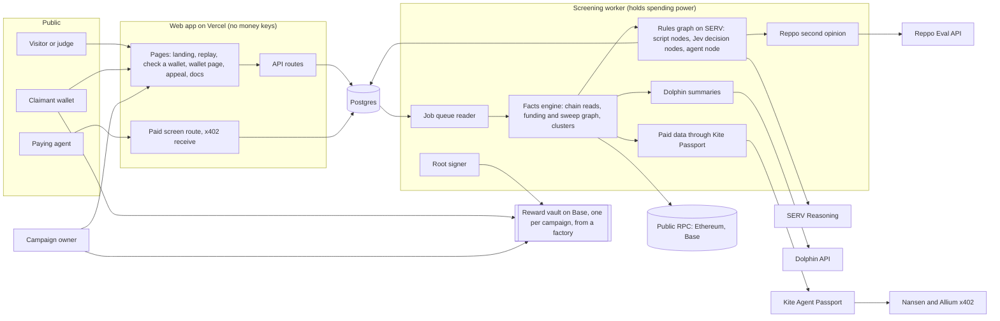
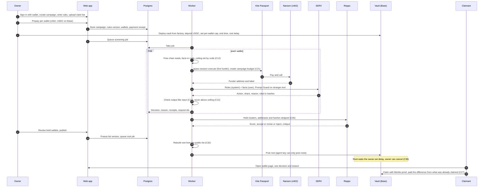
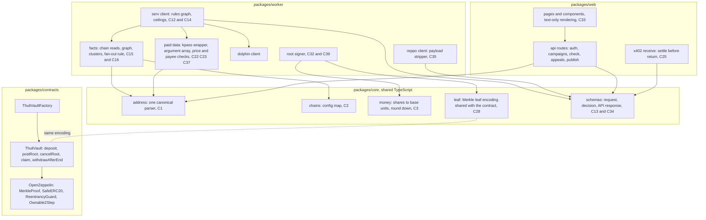

# Thuli architecture

Thuli is Tamil for "a drop": every drop of an airdrop lands in a real hand.

Picked 27 Oct 2026: a screening service with an immutable reward vault on Base (PLAN.md, Option 2). The numbered
rules (C1 to C47) are in docs/security/threat-model.md. This file grows the interface section (addresses, ABI, the
exact reads and writes the UI makes) as the backend lands.

## 1. System overview



## 2. Main sequence: one campaign, from upload to a claim



## 3. Module dependency graph



## 4. Interface for the frontend

This is what the web app builds against: where the contracts live, what each call does and how it fails, the paid API,
and the shapes the screens read. Every fact here was taken from the code on 11 Nov 2026. Where this section and the
code disagree, the code is right and this section needs an update.

### 4.1 Deployed contracts

Everything runs on Base Sepolia, Base's public testnet. There is one factory, and one vault made from it by the vault
proof run. Base mainnet is not deployed yet: there is no mainnet deployment record, and the deploy script refuses any
chain but Base Sepolia.

| What | Value |
| --- | --- |
| Network | Base Sepolia, chain id `84532` |
| ThuliVaultFactory | `0xbd2c20d2a068fe6d5052efca910d1cba44638b56` |
| Verified source | https://base-sepolia.blockscout.com/address/0xbd2c20d2a068fe6d5052efca910d1cba44638b56 |
| Factory deploy transaction | `0x5019bb52542ab56a619a0512a97fe1ad9bec61635025871b11fca532224df7f7`, block `57247894` |
| Deployment record | `packages/contracts/deployments/base-sepolia.json`, written by `npm run vault:deploy` |
| Proof vault | `0xAdb8aD5A8BC359fF17D81DBe41833bB6b26B2034`, created in block `57248098` |
| Proof vault record | `data/vault-proof/state.json`, written by `npm run prove:vault -- setup`. The `data` folder is not committed, so this file exists only on the machine that ran the proof. |

The proof vault pays Base Sepolia test USDC, caps each wallet at 1 USDC, holds 2 USDC, delays every root by one hour,
and takes claims until unix `1794976286` (18 Nov 2026, 04:31:26 UTC). Its first root lists one wallet at 1 USDC and
became claimable at unix `1794375097` (11 Nov 2026, 05:31:37 UTC). The record holds the four setup transactions
(createVault, approve, deposit, postRoot); the claim step adds a fifth entry when it runs, and the record has none yet.
Show live values from `state()` (4.2), never from these notes: the end time moves when the owner extends it or pauses.

The two records write addresses in different letter case (the factory lowercase, the vault checksummed). Case does not
change an address, so put both sides through `parseAddress` from `@thuli/core` before comparing.

### 4.2 The vault

Each campaign gets its own ThuliVault from the factory. The project running the campaign is the owner: it funds the
vault, can cancel a root while the root waits out its delay, can pause, and takes back what is left after the end.
Thuli's worker key is the agent, and all it can do is post roots. Anyone can submit a claim, and the tokens always go
to the wallet named in the leaf.

The ABI to import is `packages/worker/src/vault/abi.ts` (`@thuli/worker/src/vault/abi.ts`): `VAULT_ABI` and
`FACTORY_ABI`, both declared `as const` so viem types every read and write. The file is generated from the compiler
output in `packages/contracts/out`, a test fails if they drift apart (it skips when `out` has not been built), and it
imports nothing, so it is safe in a browser bundle. `VAULT_ABI` carries every custom error, OpenZeppelin's included.
`FACTORY_ABI` carries none, so decode a failed `createVault` against `VAULT_ABI`: the constructor's errors pass
through the factory unchanged.

Who may call: "owner" is `owner()`, "agent" is `agent()`, "pending owner" is `pendingOwner()`. Anyone else calling an
owner function gets `OwnableUnauthorizedAccount(address account)`.

#### Factory

| Function | Who | Reverts with | Emits |
| --- | --- | --- | --- |
| `createVault(address token, address owner, address agent, uint256 perWalletCap, uint64 endTime, uint32 rootDelay) returns (address vault)` | anyone | `OwnableInvalidOwner` (zero owner), `ZeroAddress` (zero token or agent), `AgentIsOwner`, `ZeroCap`, `RootDelayOutOfRange(rootDelay)` (outside 1 hour to 30 days), `EndTimeTooSoon(endTime, earliest)` (before now plus the root delay plus 1 hour), `EndTimeOutOfRange(endTime)` (more than 365 days out) | `VaultCreated(address indexed vault, address indexed owner, address indexed agent, address token, uint256 perWalletCap, uint64 endTime, uint32 rootDelay)`; the new vault emits `OwnershipTransferred` and `AgentChanged` |

The factory has no owner and no settings. Anyone can call `createVault` and name any address as owner, so a list of
vaults built from `VaultCreated` events must not treat an event as proof that the named owner asked for that vault. To
learn the new vault's address, read `vault` from the `VaultCreated` log in the receipt, keeping only logs from the
factory's address; the proof run does this and checks it against the simulated return value.

#### Vault writes

| Function | Who | Reverts with | Emits |
| --- | --- | --- | --- |
| `deposit(uint256 amount)` | owner, before the end; the owner first calls `approve(vault, amount)` on the reward token | `ZeroAmount`, `CampaignEnded`, `FeeOnTransferToken(expected, received)`, or the token's own error (or `SafeERC20FailedOperation`) when the allowance or balance is short | `Deposited(address indexed from, uint256 amount, uint256 totalDeposited)` |
| `postRoot(bytes32 root, uint256 declaredTotal)` | agent only; the web app never sends this | `NotAgent(caller)`, `EnforcedPause`, `ZeroRoot`, `CampaignEnded`, `DeclaredTotalAboveDeposit(declaredTotal, deposited)`, `RootWouldNotActivate(claimableAt, endTime)` | `RootActivated` when a pending root was already due, `RootCancelled` for a pending root it replaces, then `RootPosted(bytes32 indexed root, uint256 declaredTotal, uint64 claimableAt)` |
| `cancelRoot()` | owner, while the pending root is still inside its delay, paused or not | `NoPendingRoot`, `RootAlreadyClaimable(claimableAt)` | `RootCancelled(bytes32 indexed root)` |
| `setAgent(address newAgent)` | owner | `ZeroAddress`, `AgentIsOwner` | `RootActivated` when a pending root was already due, `RootCancelled` for a pending root still inside its delay, then `AgentChanged(address indexed previousAgent, address indexed newAgent)` |
| `extendEnd(uint64 newEnd)` | owner, before the end | `CampaignEnded`, `EndTimeOutOfRange(endTime)` when `newEnd` is not later than the current end or is more than 365 days from now | `EndExtended(uint64 previousEnd, uint64 newEnd)` |
| `pause()` | owner | `EnforcedPause` when already paused | `RootActivated` when a pending root was already due, then `Paused(address account)` |
| `unpause()` | owner | `ExpectedPause` when not paused | `Unpaused(address account)`; when any time passed while paused, `RootDelayed(bytes32 indexed root, uint64 claimableAt)` for a pending root and `EndExtended`. The end time and any pending root move later by exactly the time spent paused. |
| `claim(address account, uint256 cumulativeAmount, bytes32[] proof)` | anyone; the tokens go to `account` | `EnforcedPause`, `ZeroAddress`, `CampaignEnded`, `NoClaimableRoot`, `InvalidProof`, `NothingToClaim(account)`, `DepositExhausted(amount, available)` | `RootActivated` when it records a due root, then `Claimed(address indexed account, uint256 amount, uint256 cumulative)` |
| `withdrawAfterEnd(address to)` | owner, from the end time on, not while paused; sends the whole reward token balance | `EnforcedPause`, `ZeroAddress`, `CampaignNotEnded`, `NothingToWithdraw` | `Withdrawn(address indexed to, uint256 amount)` |
| `rescue(address otherToken, address to, uint256 amount)` | owner, any time; never the reward token | `RewardTokenNotRescuable`, `ZeroAddress`, `ZeroAmount` | `Rescued(address indexed token, address indexed to, uint256 amount)` |
| `transferOwnership(address newOwner)` | owner; the zero address cancels a transfer in progress | `AgentIsOwner` | `OwnershipTransferStarted(address indexed previousOwner, address indexed newOwner)` |
| `acceptOwnership()` | pending owner | `OwnableUnauthorizedAccount`, `AgentIsOwner` when the pending owner has since become the agent | `OwnershipTransferred(address indexed previousOwner, address indexed newOwner)` |
| `renounceOwnership()` | nobody: declared `pure` and always reverts | `RenounceDisabled` | nothing. Leave it out of the UI. |

`deposit`, `claim`, `withdrawAfterEnd` and `rescue` are also guarded against reentry (`ReentrancyGuardReentrantCall`).

`RootActivated` fires only when some transaction records the activation (a claim, a new root, a pause or an agent
change). A root starts paying the moment its delay ends, before any such event, so show the active root from
`state()`, never from the event log.

#### Vault reads

Use `state()` for the vault page. It returns a struct (`VaultState memory`), so viem hands back an object with named
fields. Every other view returns a single value, and viem returns that value directly. The vault has one public
mapping, `claimed`, and it holds a plain number, not a struct, so no read anywhere returns a tuple to unpack by
position. viem decodes `uint32` as a JavaScript number and `uint64` and `uint256` as bigint; the worker's own reads
rely on this.

`state()` fields, in order:

| # | Field | Solidity | viem | Meaning |
| --- | --- | --- | --- | --- |
| 1 | `token` | address | string | the reward token |
| 2 | `owner` | address | string | the project running the campaign |
| 3 | `agent` | address | string | the root-posting key |
| 4 | `perWalletCap` | uint256 | bigint | the most one wallet can ever receive, in token base units |
| 5 | `endTime` | uint64 | bigint | claims are accepted while block time is below this, withdrawal from it on |
| 6 | `rootDelay` | uint32 | number | seconds every root waits before it pays |
| 7 | `deposited` | uint256 | bigint | everything the owner has deposited |
| 8 | `totalPaid` | uint256 | bigint | everything paid to claimants |
| 9 | `activeRoot` | bytes32 | hex string | the root claims prove against; a pending root whose delay is over already shows here |
| 10 | `pendingRoot` | bytes32 | hex string | the root waiting out its delay, all zeros when there is none |
| 11 | `pendingClaimableAt` | uint64 | bigint | when the pending root starts paying, zero when there is none; while paused, the time it would have if the vault were unpaused now |
| 12 | `paused` | bool | boolean | whether the vault is paused |

Other views:

| View | Solidity | viem | Notes |
| --- | --- | --- | --- |
| `claimable(address account, uint256 cumulativeAmount)` | uint256 | bigint | what a claim with a valid proof would pay right now. It does not check the proof. Zero when paused, ended, no claimable root, nothing new for this wallet, or not enough deposit left. |
| `claimed(address account)` | uint256, public mapping getter | bigint | everything the account has received from this vault |
| `token()`, `owner()`, `pendingOwner()`, `agent()` | address | string | `pendingOwner` is zero when no transfer is in progress |
| `perWalletCap()`, `deposited()`, `totalPaid()` | uint256 | bigint | the same values `state()` gives |
| `endTime()` | uint64 | bigint | |
| `rootDelay()` | uint32 | number | |
| `paused()` | bool | boolean | |
| `MIN_ROOT_DELAY()`, `MAX_ROOT_DELAY()`, `MIN_CLAIM_WINDOW()` | uint32 | number | 1 hour, 30 days, 1 hour, in seconds |
| `MAX_END_AHEAD()` | uint64 | bigint | 365 days, in seconds |

The roots have no getters of their own; read them from `state()`.

### 4.3 Leaves and proofs

A claim list becomes one Merkle root on the vault. Each wallet's leaf holds its total entitlement across every root so
far, and the vault pays the difference from what it has already paid that wallet, never more than the per-wallet cap.

The leaf, exactly as the vault hashes it:

```text
leaf = keccak256(bytes.concat(keccak256(abi.encode(uint256 chainId, address vault, address account, uint256 cumulativeAmount))))
```

This is OpenZeppelin StandardMerkleTree's leaf for the types `['uint256', 'address', 'address', 'uint256']`, and the
vault checks proofs with OpenZeppelin `MerkleProof.verifyCalldata`. The chain id and the vault address sit inside the
leaf, so a proof for one vault or chain is worthless on another.

The functions that build leaves, trees and proofs:

- `leafValues(chainId: number | string, vault: string, account: string, cumulativeAmount: bigint): LeafValues` in
  `packages/core/src/leaf.ts`. One leaf as text, `[chainId, vault, account, cumulativeAmount]`: chain id and amount as
  decimal text, both addresses checksummed. Throws `AddressError`, `ChainError` (a chain not in core's list: 1, 8453,
  84532) or `LeafError` (the amount is not a bigint inside uint256).
- `buildTree(entries: readonly LeafValues[]): LeafTree` in the same file. Refuses an empty list, an entry not made by
  `leafValues`, mixed chains or vaults, and a wallet listed twice.
- `proofFor(tree: LeafTree, account: string): MerkleHash[]` in the same file. The `bytes32[]` proof for one wallet,
  written in any address spelling. Throws `LeafError` when the wallet has no leaf.
- `buildRoot(entries: readonly VaultEntry[], vault: string, chainId: number | string): { root, tree }` in
  `packages/worker/src/vault/root.ts`. `leafValues` plus `buildTree` for a whole list, where `VaultEntry` is
  `{ account: string; cumulativeAmount: bigint }`.
- `publishList(entries): string` and `readPublishedList(text: string): VaultEntry[]` in the same file. The published
  list is a JSON array of `{ "account": checksummed address, "cumulativeAmount": decimal string }`, at most 100,000
  entries, and anyone can rebuild the root from it.

The first three are exported by `@thuli/core`, whose entry point is its TypeScript source (`packages/core/src/index.ts`).
The last two live in the worker.

What a claimant's browser needs to hold to claim:

- `account`: the wallet in the leaf. The transaction can come from any wallet, because the vault always pays `account`.
- `cumulativeAmount`: the leaf's amount as a bigint, in the reward token's base units (USDC has 6 decimals, so 1 USDC
  is `1000000`).
- `proof`: the `bytes32[]` from `proofFor`, built from the same published list the root was built from.
- the vault address, on chain `84532`.

Before sending, call `claimable(account, cumulativeAmount)` to show what the claim would pay (zero means nothing to
claim now), then simulate `claim(account, cumulativeAmount, proof)` so an `InvalidProof` shows before the wallet asks
for a signature. The proof run does the same: it rebuilds the tree from the published list, checks the rebuilt root
equals `state().activeRoot`, reads `claimable`, then simulates and sends `claim`.

No file or route serves a wallet its proof or a campaign's published list yet, and nothing yet turns a decision's share
into a wallet's `cumulativeAmount` (the proof run wrote its amount by hand). See 4.8.

### 4.4 The paid API

One paid route screens one Ethereum wallet for $0.05 in USDC, paid over x402 (HTTP 402 payments). The usual buyer is an
agent or a script, and a "check a wallet" screen can buy the same way. The payment settles before the screening runs,
and one payment buys exactly one screening.

| Route | Method | Price | Limits apply |
| --- | --- | --- | --- |
| `/api/x402/screen` | POST | `$0.05`, exactly `50000` USDC base units | yes |
| `/api/x402/health` | GET | free | no |

Request: `content-type: application/json` and a body of exactly `{"wallet": "0x..."}`: one key, a string of at most 64
characters, at most 1 KB in all. The address may be all lowercase, all uppercase, or mixed case with a correct
checksum.

Payment header: `PAYMENT-SIGNATURE` (x402 version 2). `X-PAYMENT`, the version 1 name, is read too. The x402 client
libraries build the header from the 402 terms: `wrapFetchWithPayment` in `@x402/fetch`, or
`x402HTTPClient.encodePaymentSignatureHeader` in `@x402/core/client`, with `ExactEvmScheme` from
`@x402/evm/exact/client`. All x402 packages are pinned at 2.30.0.

The 402 answer. With no payment header, the route answers 402 with the JSON body `{"error": "Payment required"}` and
the terms in the `PAYMENT-REQUIRED` header, which is base64 of a JSON object:

- `x402Version`: `2`
- `error`: `"Payment required"`
- `resource`: `{ url, description, mimeType: "application/json" }`. `url` is `PUBLIC_ORIGIN` plus the path when that is
  set (Base mainnet requires it), otherwise the request's own URL.
- `accepts`: one entry, `{ scheme: "exact", network, amount: "50000", asset, payTo, maxTimeoutSeconds: 300, extra }`.
  `network` is `eip155:84532` on Base Sepolia or `eip155:8453` on Base. `asset` is that network's USDC:
  `0x036CbD53842c5426634e7929541eC2318f3dCF7e` on Base Sepolia, `0x833589fCD6eDb6E08f4c7C32D4f71b54bdA02913` on Base.
  `extra` holds `paymentFlow: "upfront"` plus any token details the x402 library adds for signing.
- `extensions.bazaar`: the discovery listing, with an input example and the JSON schema of the success body below.

A request that looks like a browser page load (an Accept header with `text/html` and a Mozilla user agent) gets the
x402 library's HTML paywall instead of the JSON body. A `fetch` from the web app does not, unless it sets that Accept
header.

The success answer is 200, with a `PAYMENT-RESPONSE` header (base64 JSON with `success: true`, `transaction`,
`network`, `payer`) and exactly this body:

| Field | Type |
| --- | --- |
| `wallet` | checksummed address, the one paid for |
| `checkedAt` | ISO 8601 date and time |
| `scope` | always `"one wallet on Ethereum, no claim list"` |
| `rulebook` | always `"v2"` |
| `decision.action` | `"full"`, `"partial"`, `"hold"` or `"exclude"` |
| `decision.shareBps` | whole number from 0 to 10000: full is 10000, partial is the settings' partial share (5000 by default), hold and exclude are 0 |
| `decision.rule` | `A1` to `A9`, `B1` or `B2` |
| `decision.reason` | plain text, 1 to 400 characters, no control characters or text-direction overrides |
| `decision.citedTxs` | up to 256 transaction hashes, each `0x` and 64 lowercase hex |
| `servRequestId` | SERV's run id (letters, digits, `.`, `_`, `:`, `-`, up to 128 characters) or null |
| `notChecked` | the facts this screening never measures, today always `["group", "sharedDepositAddress", "fundingBurst", "claimPaidToOtherAddress"]` |
| `payment.network` | `"eip155:84532"` or `"eip155:8453"` |
| `payment.payer` | checksummed address that paid |
| `payment.transaction` | the settlement transaction hash, `0x` and 64 lowercase hex |

A paid request always gets a decision. If the screening fails, or its result fails the output check, the body is a hold
with rule `A1` and a reason reading `Held for review: <cause>.` Show `reason` as text only, never as HTML or markdown.
A screening can take up to 120 seconds, so the screen needs a long wait state.

Once a settlement is confirmed, the buyer always gets the result, whatever happens to the store that keeps the claims
and limits. If the store cannot mark the payment used or count the screening, the failure is logged and the claim
simply stays held until its validBefore, so no copy of the header is ever served. Before a settlement is confirmed, a
store that cannot be reached refuses instead (the two `503` rows below), and nothing is settled on a claim the store
could not record.

Errors, in the order the route checks for them:

| Status | Body | When |
| --- | --- | --- |
| 400 | `{"error": "the client address could not be read"}` | the caller's IP address is unknown (see mounting below) |
| 429 | `{"busy": true}` | this caller is past one of its own limits |
| 503 | `{"busy": true}` | the store that keeps the limits could not be reached; nothing was asked for or run |
| 413 | `{"error": "the body is too large"}` | the body is over 1 KB |
| 400 | `{"error": "the body must be JSON like {\"wallet\": \"0x...\"}"}` | the body is not JSON |
| 400 | `{"error": "the body must be exactly {\"wallet\": \"0x...\"}"}` | other keys, or `wallet` is not a string of at most 64 characters |
| 400 | `{"error": "wallet rejected: <cause>"}` | the cause is `not a 0x address of 40 hex characters` or `mixed-case address with a wrong checksum, likely a typo` |
| 503 | `{"busy": true}` | the server is at its own ceiling (limits below), or its memory of payments is full |
| 503 | `{"busy": true}` | the store that keeps the ceilings could not be reached; no payment was asked for |
| 402 | `{"error": "Payment required"}` with `PAYMENT-REQUIRED` | no payment header |
| 402 | `{"error": "No matching payment requirements"}` with a fresh `PAYMENT-REQUIRED` | the payment header does not match the terms |
| 402 | `{}` with `PAYMENT-RESPONSE` holding `success: false` and an `errorReason` | the payment was refused at settlement. Thuli's own reasons: `payment_not_understood`, `payment_terms_mismatch`, `payment_expired`, `payment_valid_too_long` (signed to stay valid past 300 seconds plus a 30 second clock allowance), `payment_already_used`. A facilitator failure carries the facilitator's reason. |
| 503 | `{"retry": true}` | the store could not record the claim on this payment, so it was not settled. Send the same payment header again. |
| 503 | `{"retry": true}` | the settlement's outcome is unknown. Send the same payment header again; it can never pay twice. |
| 500 | `{"error": "the payment could not be confirmed"}` or `{"error": "internal error"}` | an internal fault; no detail is returned |

Limits. With `DATABASE_URL` set, the payment claims, these limits and the day count live in Postgres and are shared by
every copy of the server, so a host that runs many short-lived copies still has one allowance and one memory of
payments. A place a copy took and never gave back, because it crashed, frees itself after 330 seconds, longer than the
slowest paid request. Without `DATABASE_URL` they live in each process's memory, count per process, and reset on a
restart, which is right only for one long-running server. A caller is its IP address: IPv4 as it is, IPv6 grouped by
its /64 network.

| Limit | Value |
| --- | --- |
| Paid requests in flight per caller | 1 |
| Requests per caller in any 60 seconds, paid or not | 20 |
| Paid attempts per caller in any hour that end without a settled payment | 5 |
| Callers tracked at once | 100,000 in memory, the least recently seen idle caller forgotten first. The shared store has no such cap; a regular sweep deletes rows no limit needs any more |
| Paid requests in flight on the whole service | 4 |
| Screenings started per UTC day on the whole service | 600 in memory. The shared store stops new paid requests 4 short, at 596, so the four that may be running can always finish without passing 600 |
| SERV calls per screening | 12 |
| Time per screening | 120 seconds, then a hold |

Health: `GET /api/x402/health` returns `{"network": "eip155:84532", "payTo": "<address>", "price": "$0.05", "scope":
"one wallet on Ethereum, no claim list"}`, with `network` set to `eip155:8453` on Base. No payment, no limits.

Mounting. The API is a Hono app built by `createApp(config: ApiConfig, deps: ApiDeps): Hono` in
`packages/api/src/app.ts`. Its routes carry their full paths, so the Next.js app can hand every request under
`/api/x402/` and `/api/check` to the app's `fetch` unchanged. The pieces:

- `loadApiConfig(env)` in `packages/api/src/config.ts` reads and checks the settings: `X402_NETWORK` (`base` or
  `base-sepolia`, no default); `PAYTO_ADDRESS_TESTNET` on Base Sepolia or `PAYTO_ADDRESS` on Base; `CDP_API_KEY_ID`,
  `CDP_API_KEY_SECRET`, `PUBLIC_ORIGIN` and `BASE_RPC_URL` on Base; optional `FACILITATOR_URL` on Base Sepolia;
  optional `TRUSTED_CLIENT_HEADER`; optional `DATABASE_URL`, a `postgres://` or `postgresql://` URL; and `PORT` for the
  standalone server. It refuses to start while any variable whose name ends in `PRIVATE_KEY` is set, so the web app's
  server environment must hold no private key. The database URL holds a password, so it is kept out of anything that
  prints the config, and no error message contains it.
- `deps.stores` is where the claims, limits and cached checks live: `postgresStores(connectPostgres(url), now)` from
  `packages/api/src/stores.ts` when `DATABASE_URL` is set, and this process's memory when it is left out. The app
  starts a sweep of the store on every 200th request without waiting for it.
- `liveScreen(env)` in `packages/api/src/live.ts` returns `deps.screen`, the real screening (4.5).
- `packages/api/src/server.ts` runs the same app on its own, on port 8787 by default (`npm run api:dev`). With
  `DATABASE_URL` set it brings the schema up to date once at start, then sweeps at start and every 10 minutes.

The app reads the caller's IP from the Node socket through `@hono/node-server`, which a Next.js route handler does not
provide. Inside Next.js, `TRUSTED_CLIENT_HEADER` must name the header the host writes the caller's IP into, such as
`x-vercel-forwarded-for`; without it every POST answers 400. The package has no entry file or exports map, so it is
imported by file path, the way it imports the worker today (`@thuli/worker/src/screen/single.ts`).

### 4.4b The free check

`POST /api/check` is what the site's check box calls: anyone pastes a wallet and gets a decision, with no sign-in and
no payment. It runs the same screening as the paid route (4.5). It never buys data and never asks for or takes a
payment, so its only cost is model credit, and that cost has the ceilings below (C24).

`GET /api/check/health` returns `{"scope": "one wallet on Ethereum, no claim list", "rulebook": 2, "price": "free"}`.

Request: the paid route's rules exactly. `content-type: application/json`, a body of exactly `{"wallet": "0x..."}`, at
most 1 KB, the same address parsing and the same error bodies.

The success answer is 200 with exactly this body, the paid reply's fields without `payment` and with `cached`:

| Field | Type |
| --- | --- |
| `wallet` | checksummed address, the one checked |
| `checkedAt` | ISO 8601 date and time of the screening; a cached answer keeps the time of its first screening |
| `scope` | always `"one wallet on Ethereum, no claim list"` |
| `rulebook` | always `"v2"` |
| `decision` | `action`, `shareBps`, `rule`, `reason` and `citedTxs`, exactly as in the paid reply (4.4) |
| `servRequestId` | SERV's run id or null |
| `notChecked` | the facts this screening never measures, as in the paid reply |
| `cached` | `true` when the answer came from the cache, `false` for a new screening |

The body passes the same output check as the paid reply. A screening whose result fails it becomes a hold on `A1`
reading `Held for review: the result did not pass the output check.`, and a screening that fails becomes a hold on `A1`
with its cause. Show `reason` as text only.

Cache. Results are kept by canonical address, chain 1 and rulebook version, so every spelling of one wallet shares one
entry and one model run. A result the rulebook's checks accepted is kept 24 hours. A hold because the screening failed
or its answer was refused is kept 5 minutes, so an outage is not frozen in for a day and still cannot be hammered. A
cached answer is checked like a new one before it goes out. With `DATABASE_URL` set the cache is shared by every copy of
the server; without it each process keeps at most 10,000 answers and forgets expired ones first.

One screening per wallet at a time. While a screening of an address runs, another request for that address, in any
spelling, gets 202 with exactly `{"pending": true}` and starts nothing. Ask again a few seconds later: once the screening
ends the answer is in the cache. A screening can take up to 120 seconds.

Ceilings. A cached answer runs nothing and counts toward none of these but the first. Only a check that starts a
screening counts toward the hour and the day, and a refused check counts nothing. With `DATABASE_URL` set every ceiling
is shared by every copy of the server. A caller is its IP address, named exactly as on the paid route.

| Ceiling | Value | Past it |
| --- | --- | --- |
| Requests per caller in any 60 seconds, cached or not, counted apart from the paid route's | 20 | 429 `{"busy": true}` |
| New checks per caller in any hour | 5 | 429 `{"busy": true}` |
| New checks running per caller | 1 | 429 `{"busy": true}` |
| New checks running on the whole service | 2 | 503 `{"busy": true}` |
| New checks started on the whole service per UTC day | 300 | 503 `{"busy": true}` |

Answers, in the order the route checks for them:

| Status | Body | When |
| --- | --- | --- |
| 400 | `{"error": "the client address could not be read"}` | the caller's IP address is unknown, as on the paid route |
| 429 | `{"busy": true}` | this caller is past its 60 second allowance |
| 503 | `{"busy": true}` | the store could not be reached at any step before a screening; nothing was started |
| 413 or 400 | the paid route's bodies | the body is too large, not JSON, not exactly `{"wallet": "0x..."}`, or names a bad address |
| 200 | the body above with `cached: true` | the wallet's answer is in the cache |
| 202 | `{"pending": true}` | another request is screening this wallet right now |
| 429 | `{"busy": true}` | this caller is past its hour, or already has a check running |
| 503 | `{"busy": true}` | the service has two checks running, or today's 300 are used |
| 200 | the body above with `cached: false` | a new screening |

Once a screening has run its result goes out, even when the store cannot keep it in the cache.

### 4.5 Screening one wallet without a claim list

The paid route runs the replay's rulebook on one wallet with no claim list around it. With no list there is no group,
no funding burst and no shared deposit address to measure, so those facts are marked not checked instead of being
counted as doubt.

The function is `screenOneWallet(wallet: string, deps: SingleScreenDeps): Promise<SingleScreen>` in
`packages/worker/src/screen/single.ts`.

- `deps` is `{ facts(wallet): Promise<Facts>; decide: DecideDeps; settings: Settings }`. `liveScreen(env)` in
  `packages/api/src/live.ts` builds the real one: facts read at the latest finalized Ethereum block, then SERV in auto
  mode (the rules graph first, rulebook v2 if the graph fails), with the default settings.
- It throws `AddressError` for a bad address before reading anything or calling anyone, so a caller can refuse before
  taking payment. After that it never throws. Every failure ends in a hold with rule `A1` and one of these causes:
  "the wallet facts could not be read", "SERV gave no answer", "the screening service is out of credit", "the spend
  cap for one screening was reached", "the screening ran out of time", "the screening could not finish".
- It makes at most 12 SERV calls, and starts none after 120 seconds.

Environment, names only, read by `liveScreen` through the worker's settings check: `SERV_API_KEY`, `SERV_BASE_URL`,
`SERV_GRAPH_ID` (must name a graph Thuli has a translation for), `ETH_RPC_URL`, `BLOCKSCOUT_ETH_API`. The three URLs
must be https. It also reads the rulebook text from `packages/rulebook/thuli-rulebook.md`.

The result, `SingleScreen`:

| Field | Type |
| --- | --- |
| `wallet` | checksummed address |
| `checkedAt` | ISO 8601 date and time |
| `decision` | the worker's full `DecisionRecord` (below) |
| `servRequestId` | string or null |
| `rulebook` | `"v2"` |
| `scope` | `"one wallet on Ethereum, no claim list"` |
| `notChecked` | `["group", "sharedDepositAddress", "fundingBurst", "claimPaidToOtherAddress"]` |

`DecisionRecord` holds `wallet`, `mode` (`v3` for the graph, `v2` for the rulebook), `fallback`, `start` (`{ outcome,
rule }`), `ceiling`, `requestId`, `rawText`, `usage`, `verdict`, `modelAction`, `modelRule`, `action`, `shareBps`,
`rule`, `reason`, `citedTxs`, `clampedFrom`, `accepted`, `cause`, `secondAsk` and `firstCause`. It includes the
model's raw reply, so it must never reach a browser as it is. The paid route copies out only `action`, `shareBps`,
`rule`, `reason` and `citedTxs` (4.4), and any new screen should do the same.

What it marks as not checked: `group` (linked wallets on the same list), `sharedDepositAddress` (a deposit address
shared with other claimants), `fundingBurst` (many list wallets funded at once) and `claimPaidToOtherAddress` (no claim
has been made yet). Any other fact that could not be read still holds the wallet on `A1`.

### 4.6 Appeals

A wallet that disagrees with its decision can appeal, one open appeal per wallet per campaign. It signs a fixed message
with its own key, the server checks it, a model may add advice, and only the campaign owner settles it. Advice never
changes a decision on its own.

The message, built by `appealMessage({ campaignId, wallet, textHash, signedAt })` in `packages/core/src/appeal.ts`, is
five lines, each ending in a newline:

```text
Thuli appeal v1
Campaign: <campaignId>
Wallet: <checksummed address>
Appeal text SHA-256: <0x and 64 lowercase hex>
Signed at: <unix seconds>
```

- `campaignId` is 1 to 128 letters, digits, dots, dashes or underscores.
- The hash is `appealTextHash(text)`: SHA-256 of the UTF-8 bytes of the text exactly as stored. The browser computes
  it the same way to build the message. The server never takes a hash from the client; it rebuilds it from the text.
- The wallet signs the message as a plain personal message (EIP-191, viem `signMessage`). The signature is 65 bytes,
  `0x` and 130 hex.

The browser sends `{ campaignId, wallet, text, signedAt, signature }` (`AppealInput`).

`checkAppeal(input, { expectedCampaignId, now, isContract })` returns `{ ok: true, wallet, textHash }` or
`{ ok: false, cause }` and never throws. `isContract` must answer true only for account type `contract`: a delegated
EOA keeps its own key and counts as a person's wallet. The checks stop at the first failure, in this order, each with a
fixed cause:

| Check | Cause |
| --- | --- |
| the wallet is an address | "the wallet is not a valid address" |
| the text is not empty or only spaces | "the appeal text is empty" |
| the text is at most 1000 characters | "the appeal text is longer than 1000 characters" |
| the text is plain: no `http`, `www.`, `<`, `>` or `](`, no control or invisible format characters, no broken unicode | "the appeal text contained a link, markup or control characters" |
| the campaign is the one the server expected | "this appeal is for a different campaign" |
| `signedAt` is whole seconds | "the signing time is not a whole number of seconds" |
| signed at most 600 seconds ago | "the signature is too old" |
| dated at most 60 seconds ahead | "the signature is dated in the future" |
| the wallet is not a contract | "contract wallets cannot appeal yet", or "the wallet type could not be checked" |
| the signature matches the rebuilt message | "the signature does not match this appeal" |

So the screen builds the message, asks for the signature, and sends the appeal within ten minutes.

The stored record, `AppealRecord`:

| Field | Type |
| --- | --- |
| `campaignId` | campaign id as above |
| `wallet` | checksummed address |
| `text` | 1 to 1000 characters |
| `textHash` | must equal `appealTextHash(text)` |
| `signedAt` | whole seconds |
| `signature` | `0x` and 130 hex |
| `appealedAction` | `full`, `partial`, `hold` or `exclude` |
| `appealedRule` | `A1` to `A9`, `B1` or `B2` |
| `advice` | `"reverse"`, `"uphold"`, `"unclear"` or null |
| `adviceReason` | up to 280 characters, or null |
| `adviceRequestId` | up to 128 characters, or null |
| `status` | `"open"`, `"reversed"` or `"upheld"` |
| `newAction` | an outcome when reversed, otherwise null |
| `ownerNote` | up to 1000 characters, or null |

Storage: `AppealStore` in `packages/worker/src/appeal/store.ts` adds one JSON line per change to a file, keyed by
campaign and wallet. `openAppeal(record)` returns `{ stored: true }`, or `{ stored: false, cause }` with "this appeal is
already stored" or "an appeal is already open for this wallet in this campaign". `get(campaignId, wallet)` and
`forCampaign(campaignId)` read back the latest state of each appeal.

Advice: `adviseOnAppeal(record, appealedAction, reason, appealText, conn)` in `packages/worker/src/appeal/advice.ts`
asks SERV, with its prompt guard declared, and returns `{ advice, reason, requestId }`. Any failure gives `"unclear"`
with a null reason. No code turns advice into a status.

Settling: `settleAppeal(record, { confirmed, outcome, newAction, note })` in `packages/core/src/appeal.ts` returns a
new record. It requires `confirmed: true`, which must come from the owner's signed-in session. `"upheld"` takes no
`newAction`; `"reversed"` needs a `newAction` more generous than the appealed action. Then `store.saveSettled(record)`
replaces the open line, and refuses a stale copy of an appeal already settled.

Not built yet:

- No public route takes or lists appeals, so the rate limit on appeals does not exist either.
- No owner sign-in, so nothing can supply `confirmed: true` from a real session yet.
- Contract wallets cannot appeal.
- The store is a local file, safe for one process only.
- A reversal does not change the claim list or the vault root. Today only the rulebook version scorer reads settled
  appeals.

### 4.7 Replay files for the landing page

`npm run export:replay` writes these static files from the stored replay, under `packages/web/public/replay/`:

- `robo/summary.json`: every headline number, the run date, the rulebook version, the SHA-256 of the two input files,
  and one entry per linked group.
- `robo/points.json`: one entry per claim wallet, in claim-list order: outcome code 0 full, 1 partial, 2 hold,
  3 exclude; group index or -1; whole ROBO claimed; funding-burst flag. It holds no wallet address.
- `robo/wallets/00.json` to `robo/wallets/ff.json`: one entry per claim wallet, keyed by lowercase address and filed
  under the address's first two hex characters. Each entry holds the outcome, the share, the rule, the reason as plain
  text, the cited transactions, the facts behind the decision and the SERV run id.
- `robo/groups/<index>.json`: one linked family, with every member wallet in claim-list order.
- `versions.json`: the scorecard of rulebook v1 against v2, both scored on the same stored model replies.
- `hop.json`: the Hop control numbers, how often the code holds Hop's probably-real wallets and its eliminated ones,
  as counts and 95% intervals only.

The replay shows what the current rulebook decides: each stored model reply is checked again with today's checks, and
no model is called. `summary.json` names that version in `run.rulebook`. No file holds a raw model reply.

### 4.8 Not built yet

Sections 1 to 3 draw the whole system. On 11 Nov 2026 the code does not have the parts below; each was checked by
searching the code.

- Postgres. There is no database code or driver. Appeals and run state live in local files.
- The web app's own routes for sign-in, campaigns, checks, appeals and publishing. `packages/web` has no API route
  handlers.
- The job queue. Nothing queues or takes jobs: the paid route screens inside the request, and the replays run as
  scripts.
- Paid data through Kite Passport, and the Nansen and Allium lookups behind it. No code calls Kite, Nansen or Allium.
- Dolphin summaries. There is no Dolphin client.
- A deployed worker host. There is no container, process manager or host configuration; the worker runs as scripts on
  one machine.
- Base mainnet contracts. Only the Base Sepolia record exists (4.1).
- The money module in section 3 ("shares to base units, round down"). Nothing turns a decision's share into a leaf
  amount.
- Half-built: the root signer. `postRoot` in `packages/worker/src/vault/root.ts` runs every check before it posts, but
  only the vault proof script calls it. No service takes a published list and posts its root.
- Half-built: the paid route inside the web app. It exists as the standalone Hono app in 4.4 and is not mounted in
  the Next.js app.
- Half-built: appeals. The checks, the record, the store and the advice exist; the public route, owner sign-in and
  rate limit do not (4.6).
