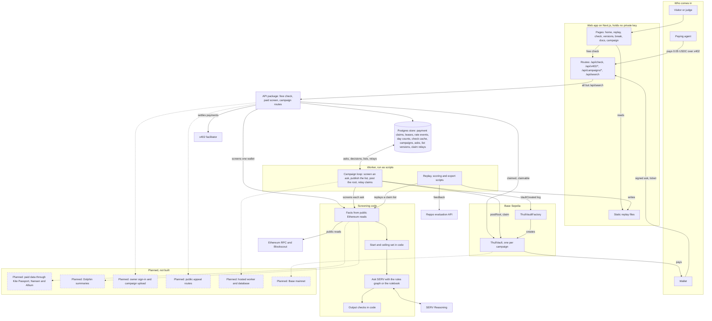
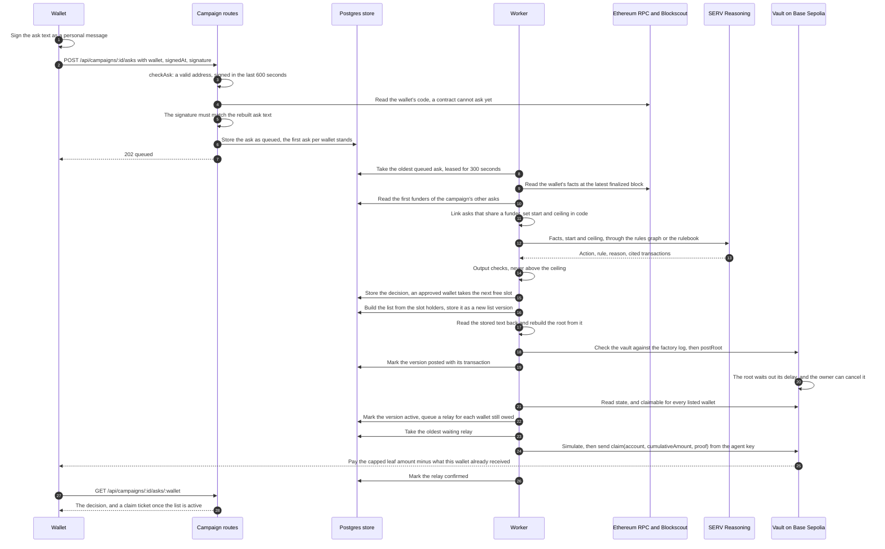
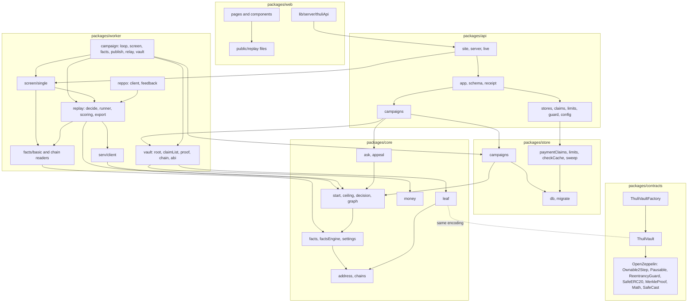

# Thuli architecture

Thuli is Tamil for "a drop": every drop of an airdrop lands in a real hand.

Picked 27 Oct 2026: a screening service with an immutable reward vault on Base. The numbered
rules (C1 to C47) are in docs/security/threat-model.md. This file grows the interface section (addresses, ABI, the
exact reads and writes the UI makes) as the backend lands.

## 1. System overview

What runs today, drawn from the code on 11 Nov 2026. Solid lines are built. Every dashed line leads into the planned
box, and nothing in that box is built yet.



## 2. Main sequence: one wallet through an open campaign

One wallet from its signed ask to its payout, as the API, the store and the worker do it today. Every step here is in
the code; the worker runs as a script on one machine, and hosting it is planned (section 1).



## 3. Module dependency graph

The packages and their main modules. An arrow points from a module to one it imports, and only the main imports are
drawn. The one dashed line is not an import: core's leaf and the vault hash a claim the same way.



## 4. Interface for the frontend

This is what the web app builds against: where the contracts live, what each call does and how it fails, the paid API,
and the shapes the screens read. Every fact here was taken from the code on 11 Nov 2026. Where this section and the
code disagree, the code is right and this section needs an update.

### 4.1 Deployed contracts

Everything runs on Base Sepolia, Base's public testnet. There is one factory, and one vault made from it by the vault
proof run. Base mainnet is not deployed yet: there is no mainnet deployment record, and the deploy script refuses any
chain but Base Sepolia.

| What | Value |
| --- | --- |
| Network | Base Sepolia, chain id `84532` |
| ThuliVaultFactory | `0xbd2c20d2a068fe6d5052efca910d1cba44638b56` |
| Verified source | https://base-sepolia.blockscout.com/address/0xbd2c20d2a068fe6d5052efca910d1cba44638b56 |
| Factory deploy transaction | `0x5019bb52542ab56a619a0512a97fe1ad9bec61635025871b11fca532224df7f7`, block `57247894` |
| Deployment record | `packages/contracts/deployments/base-sepolia.json`, written by `npm run vault:deploy` |
| Proof vault | `0xAdb8aD5A8BC359fF17D81DBe41833bB6b26B2034`, created in block `57248098` |
| Proof vault record | `packages/contracts/deployments/base-sepolia-proof.json`, rebuilt by `npm run prove:vault -- record`, which reads the run back from Base Sepolia, loads no key and sends nothing. |
| Check the record yourself | `npm run prove:vault -- verify` checks the committed record against Base Sepolia line by line (each of the five receipts with its block, sender and gas, the VaultCreated, RootPosted, Claimed and USDC Transfer events in them, and the vault's `state()` and `claimed()` today), and needs only the two committed records and an RPC URL, the public `https://sepolia.base.org` when `BASE_SEPOLIA_RPC_URL` is unset. |

The proof vault pays Base Sepolia test USDC, caps each wallet at 1 USDC, holds 2 USDC, delays every root by one hour,
and was created to take claims until unix `1794976286` (18 Nov 2026, 04:31:26 UTC). On 11 Nov 2026 the owner moved
the end to unix `1804756909` (11 Mar 2027, 09:21:49 UTC) with `extendEnd`, in transaction
`0x37f8a85af0c454c01a1477dca238edc05ffe4e5a2e75ab410998f0a566459dd6`, so the attack page keeps reading a vault that is
still open. Its first root lists one wallet at 1 USDC and
became claimable at unix `1794375097` (11 Nov 2026, 05:31:37 UTC). The record holds five transactions: the four setup
ones (createVault, approve, deposit, postRoot) and the claim.
Show live values from `state()` (4.2), never from these notes: the end time moves when the owner extends it or pauses.

The two records write addresses in different letter case (the factory lowercase, the vault checksummed). Case does not
change an address, so put both sides through `parseAddress` from `@thuli/core` before comparing.

### 4.2 The vault

Each campaign gets its own ThuliVault from the factory. The project running the campaign is the owner: it funds the
vault, can cancel a root while the root waits out its delay, can pause, and takes back what is left after the end.
Thuli's worker key is the agent, and all it can do is post roots. Anyone can submit a claim, and the tokens always go
to the wallet named in the leaf.

The ABI to import is `packages/worker/src/vault/abi.ts` (`@thuli/worker/src/vault/abi.ts`): `VAULT_ABI` and
`FACTORY_ABI`, both declared `as const` so viem types every read and write. The file is generated from the compiler
output in `packages/contracts/out`, a test fails if they drift apart (it skips when `out` has not been built), and it
imports nothing, so it is safe in a browser bundle. `VAULT_ABI` carries every custom error, OpenZeppelin's included.
`FACTORY_ABI` carries none, so decode a failed `createVault` against `VAULT_ABI`: the constructor's errors pass
through the factory unchanged.

Who may call: "owner" is `owner()`, "agent" is `agent()`, "pending owner" is `pendingOwner()`. Anyone else calling an
owner function gets `OwnableUnauthorizedAccount(address account)`.

#### Factory

| Function | Who | Reverts with | Emits |
| --- | --- | --- | --- |
| `createVault(address token, address owner, address agent, uint256 perWalletCap, uint64 endTime, uint32 rootDelay) returns (address vault)` | anyone | `OwnableInvalidOwner` (zero owner), `ZeroAddress` (zero token or agent), `AgentIsOwner`, `ZeroCap`, `RootDelayOutOfRange(rootDelay)` (outside 1 hour to 30 days), `EndTimeTooSoon(endTime, earliest)` (before now plus the root delay plus 1 hour), `EndTimeOutOfRange(endTime)` (more than 365 days out) | `VaultCreated(address indexed vault, address indexed owner, address indexed agent, address token, uint256 perWalletCap, uint64 endTime, uint32 rootDelay)`; the new vault emits `OwnershipTransferred` and `AgentChanged` |

The factory has no owner and no settings. Anyone can call `createVault` and name any address as owner, so a list of
vaults built from `VaultCreated` events must not treat an event as proof that the named owner asked for that vault. To
learn the new vault's address, read `vault` from the `VaultCreated` log in the receipt, keeping only logs from the
factory's address; the proof run does this and checks it against the simulated return value.

#### Vault writes

| Function | Who | Reverts with | Emits |
| --- | --- | --- | --- |
| `deposit(uint256 amount)` | owner, before the end; the owner first calls `approve(vault, amount)` on the reward token | `ZeroAmount`, `CampaignEnded`, `FeeOnTransferToken(expected, received)`, or the token's own error (or `SafeERC20FailedOperation`) when the allowance or balance is short | `Deposited(address indexed from, uint256 amount, uint256 totalDeposited)` |
| `postRoot(bytes32 root, uint256 declaredTotal)` | agent only; the web app never sends this | `NotAgent(caller)`, `EnforcedPause`, `ZeroRoot`, `CampaignEnded`, `DeclaredTotalAboveDeposit(declaredTotal, deposited)`, `RootWouldNotActivate(claimableAt, endTime)` | `RootActivated` when a pending root was already due, `RootCancelled` for a pending root it replaces, then `RootPosted(bytes32 indexed root, uint256 declaredTotal, uint64 claimableAt)` |
| `cancelRoot()` | owner, while the pending root is still inside its delay, paused or not | `NoPendingRoot`, `RootAlreadyClaimable(claimableAt)` | `RootCancelled(bytes32 indexed root)` |
| `setAgent(address newAgent)` | owner | `ZeroAddress`, `AgentIsOwner` | `RootActivated` when a pending root was already due, `RootCancelled` for a pending root still inside its delay, then `AgentChanged(address indexed previousAgent, address indexed newAgent)` |
| `extendEnd(uint64 newEnd)` | owner, before the end | `CampaignEnded`, `EndTimeOutOfRange(endTime)` when `newEnd` is not later than the current end or is more than 365 days from now | `EndExtended(uint64 previousEnd, uint64 newEnd)` |
| `pause()` | owner | `EnforcedPause` when already paused | `RootActivated` when a pending root was already due, then `Paused(address account)` |
| `unpause()` | owner | `ExpectedPause` when not paused | `Unpaused(address account)`; when any time passed while paused, `RootDelayed(bytes32 indexed root, uint64 claimableAt)` for a pending root and `EndExtended`. The end time and any pending root move later by exactly the time spent paused. |
| `claim(address account, uint256 cumulativeAmount, bytes32[] proof)` | anyone; the tokens go to `account` | `EnforcedPause`, `ZeroAddress`, `CampaignEnded`, `NoClaimableRoot`, `InvalidProof`, `NothingToClaim(account)`, `DepositExhausted(amount, available)` | `RootActivated` when it records a due root, then `Claimed(address indexed account, uint256 amount, uint256 cumulative)` |
| `withdrawAfterEnd(address to)` | owner, from the end time on, not while paused; sends the whole reward token balance | `EnforcedPause`, `ZeroAddress`, `CampaignNotEnded`, `NothingToWithdraw` | `Withdrawn(address indexed to, uint256 amount)` |
| `rescue(address otherToken, address to, uint256 amount)` | owner, any time; never the reward token | `RewardTokenNotRescuable`, `ZeroAddress`, `ZeroAmount` | `Rescued(address indexed token, address indexed to, uint256 amount)` |
| `transferOwnership(address newOwner)` | owner; the zero address cancels a transfer in progress | `AgentIsOwner` | `OwnershipTransferStarted(address indexed previousOwner, address indexed newOwner)` |
| `acceptOwnership()` | pending owner | `OwnableUnauthorizedAccount`, `AgentIsOwner` when the pending owner has since become the agent | `OwnershipTransferred(address indexed previousOwner, address indexed newOwner)` |
| `renounceOwnership()` | nobody: declared `pure` and always reverts | `RenounceDisabled` | nothing. Leave it out of the UI. |

`deposit`, `claim`, `withdrawAfterEnd` and `rescue` are also guarded against reentry (`ReentrancyGuardReentrantCall`).

`RootActivated` fires only when some transaction records the activation (a claim, a new root, a pause or an agent
change). A root starts paying the moment its delay ends, before any such event, so show the active root from
`state()`, never from the event log.

#### Vault reads

Use `state()` for the vault page. It returns a struct (`VaultState memory`), so viem hands back an object with named
fields. Every other view returns a single value, and viem returns that value directly. The vault has one public
mapping, `claimed`, and it holds a plain number, not a struct, so no read anywhere returns a tuple to unpack by
position. viem decodes `uint32` as a JavaScript number and `uint64` and `uint256` as bigint; the worker's own reads
rely on this.

`state()` fields, in order:

| # | Field | Solidity | viem | Meaning |
| --- | --- | --- | --- | --- |
| 1 | `token` | address | string | the reward token |
| 2 | `owner` | address | string | the project running the campaign |
| 3 | `agent` | address | string | the root-posting key |
| 4 | `perWalletCap` | uint256 | bigint | the most one wallet can ever receive, in token base units |
| 5 | `endTime` | uint64 | bigint | claims are accepted while block time is below this, withdrawal from it on |
| 6 | `rootDelay` | uint32 | number | seconds every root waits before it pays |
| 7 | `deposited` | uint256 | bigint | everything the owner has deposited |
| 8 | `totalPaid` | uint256 | bigint | everything paid to claimants |
| 9 | `activeRoot` | bytes32 | hex string | the root claims prove against; a pending root whose delay is over already shows here |
| 10 | `pendingRoot` | bytes32 | hex string | the root waiting out its delay, all zeros when there is none |
| 11 | `pendingClaimableAt` | uint64 | bigint | when the pending root starts paying, zero when there is none; while paused, the time it would have if the vault were unpaused now |
| 12 | `paused` | bool | boolean | whether the vault is paused |

Other views:

| View | Solidity | viem | Notes |
| --- | --- | --- | --- |
| `claimable(address account, uint256 cumulativeAmount)` | uint256 | bigint | what a claim with a valid proof would pay right now. It does not check the proof. Zero when paused, ended, no claimable root, nothing new for this wallet, or not enough deposit left. |
| `claimed(address account)` | uint256, public mapping getter | bigint | everything the account has received from this vault |
| `token()`, `owner()`, `pendingOwner()`, `agent()` | address | string | `pendingOwner` is zero when no transfer is in progress |
| `perWalletCap()`, `deposited()`, `totalPaid()` | uint256 | bigint | the same values `state()` gives |
| `endTime()` | uint64 | bigint | |
| `rootDelay()` | uint32 | number | |
| `paused()` | bool | boolean | |
| `MIN_ROOT_DELAY()`, `MAX_ROOT_DELAY()`, `MIN_CLAIM_WINDOW()` | uint32 | number | 1 hour, 30 days, 1 hour, in seconds |
| `MAX_END_AHEAD()` | uint64 | bigint | 365 days, in seconds |

The roots have no getters of their own; read them from `state()`.

### 4.3 Leaves and proofs

A claim list becomes one Merkle root on the vault. Each wallet's leaf holds its total entitlement across every root so
far, and the vault pays the difference from what it has already paid that wallet, never more than the per-wallet cap.

The leaf, exactly as the vault hashes it:

```text
leaf = keccak256(bytes.concat(keccak256(abi.encode(uint256 chainId, address vault, address account, uint256 cumulativeAmount))))
```

This is OpenZeppelin StandardMerkleTree's leaf for the types `['uint256', 'address', 'address', 'uint256']`, and the
vault checks proofs with OpenZeppelin `MerkleProof.verifyCalldata`. The chain id and the vault address sit inside the
leaf, so a proof for one vault or chain is worthless on another.

The functions that build leaves, trees and proofs:

- `leafValues(chainId: number | string, vault: string, account: string, cumulativeAmount: bigint): LeafValues` in
  `packages/core/src/leaf.ts`. One leaf as text, `[chainId, vault, account, cumulativeAmount]`: chain id and amount as
  decimal text, both addresses checksummed. Throws `AddressError`, `ChainError` (a chain not in core's list: 1, 8453,
  84532) or `LeafError` (the amount is not a bigint inside uint256).
- `buildTree(entries: readonly LeafValues[]): LeafTree` in the same file. Refuses an empty list, an entry not made by
  `leafValues`, mixed chains or vaults, and a wallet listed twice.
- `proofFor(tree: LeafTree, account: string): MerkleHash[]` in the same file. The `bytes32[]` proof for one wallet,
  written in any address spelling. Throws `LeafError` when the wallet has no leaf.
- `buildRoot(entries: readonly VaultEntry[], vault: string, chainId: number | string): { root, tree }` in
  `packages/worker/src/vault/root.ts`. `leafValues` plus `buildTree` for a whole list, where `VaultEntry` is
  `{ account: string; cumulativeAmount: bigint }`.
- `publishList(entries): string` and `readPublishedList(text: string): VaultEntry[]` in the same file. The published
  list is a JSON array of `{ "account": checksummed address, "cumulativeAmount": decimal string }`, at most 100,000
  entries, and anyone can rebuild the root from it.

The first three are exported by `@thuli/core`, whose entry point is its TypeScript source (`packages/core/src/index.ts`).
The last two live in the worker.

What a claimant's browser needs to hold to claim:

- `account`: the wallet in the leaf. The transaction can come from any wallet, because the vault always pays `account`.
- `cumulativeAmount`: the leaf's amount as a bigint, in the reward token's base units (USDC has 6 decimals, so 1 USDC
  is `1000000`).
- `proof`: the `bytes32[]` from `proofFor`, built from the same published list the root was built from.
- the vault address, on chain `84532`.

Before sending, call `claimable(account, cumulativeAmount)` to show what the claim would pay (zero means nothing to
claim now), then simulate `claim(account, cumulativeAmount, proof)` so an `InvalidProof` shows before the wallet asks
for a signature. The proof run does the same: it rebuilds the tree from the published list, checks the rebuilt root
equals `state().activeRoot`, reads `claimable`, then simulates and sends `claim`.

A decision's share becomes a leaf amount through `shareOf` in `packages/core/src/money.ts`, and `buildClaimList` and
`claimTicket` in `packages/worker/src/vault/claimList.ts` build a campaign's list and one wallet's claim ticket. The
campaign routes serve a wallet its claim ticket (4.9), and the campaign worker posts lists and submits claims (4.10).

### 4.4 The paid API

One paid route screens one Ethereum wallet for $0.05 in USDC, paid over x402 (HTTP 402 payments). The usual buyer is an
agent or a script, and a "check a wallet" screen can buy the same way. The payment settles before the screening runs,
and one payment buys exactly one screening.

| Route | Method | Price | Limits apply |
| --- | --- | --- | --- |
| `/api/x402/screen` | POST | `$0.05`, exactly `50000` USDC base units | yes |
| `/api/x402/health` | GET | free | no |

Request: `content-type: application/json` and a body of exactly `{"wallet": "0x..."}`: one key, a string of at most 64
characters, at most 1 KB in all. The address may be all lowercase, all uppercase, or mixed case with a correct
checksum.

Payment header: `PAYMENT-SIGNATURE` (x402 version 2). `X-PAYMENT`, the version 1 name, is read too. The x402 client
libraries build the header from the 402 terms: `wrapFetchWithPayment` in `@x402/fetch`, or
`x402HTTPClient.encodePaymentSignatureHeader` in `@x402/core/client`, with `ExactEvmScheme` from
`@x402/evm/exact/client`. All x402 packages are pinned at 2.30.0.

The 402 answer. With no payment header, the route answers 402 with the JSON body `{"error": "Payment required"}` and
the terms in the `PAYMENT-REQUIRED` header, which is base64 of a JSON object:

- `x402Version`: `2`
- `error`: `"Payment required"`
- `resource`: `{ url, description, mimeType: "application/json" }`. `url` is `PUBLIC_ORIGIN` plus the path when that is
  set (Base mainnet requires it), otherwise the request's own URL.
- `accepts`: one entry, `{ scheme: "exact", network, amount: "50000", asset, payTo, maxTimeoutSeconds: 300, extra }`.
  `network` is `eip155:84532` on Base Sepolia or `eip155:8453` on Base. `asset` is that network's USDC:
  `0x036CbD53842c5426634e7929541eC2318f3dCF7e` on Base Sepolia, `0x833589fCD6eDb6E08f4c7C32D4f71b54bdA02913` on Base.
  `extra` holds `paymentFlow: "upfront"` plus any token details the x402 library adds for signing.
- `extensions.bazaar`: the discovery listing, with an input example and the JSON schema of the success body below.

A request that looks like a browser page load (an Accept header with `text/html` and a Mozilla user agent) gets the
x402 library's HTML paywall instead of the JSON body. A `fetch` from the web app does not, unless it sets that Accept
header.

The success answer is 200, with a `PAYMENT-RESPONSE` header (base64 JSON with `success: true`, `transaction`,
`network`, `payer`) and exactly this body:

| Field | Type |
| --- | --- |
| `wallet` | checksummed address, the one paid for |
| `checkedAt` | ISO 8601 date and time |
| `scope` | always `"one wallet on Ethereum, no claim list"` |
| `rulebook` | always `"v2"` |
| `decision.action` | `"full"`, `"partial"`, `"hold"` or `"exclude"` |
| `decision.shareBps` | whole number from 0 to 10000: full is 10000, partial is the settings' partial share (5000 by default), hold and exclude are 0 |
| `decision.rule` | `A1` to `A9`, `B1` or `B2` |
| `decision.reason` | plain text, 1 to 400 characters, no control characters or text-direction overrides |
| `decision.citedTxs` | up to 256 transaction hashes, each `0x` and 64 lowercase hex |
| `servRequestId` | SERV's run id (letters, digits, `.`, `_`, `:`, `-`, up to 128 characters) or null |
| `notChecked` | the facts this screening never measures, today always `["group", "sharedDepositAddress", "fundingBurst", "claimPaidToOtherAddress"]` |
| `payment.network` | `"eip155:84532"` or `"eip155:8453"` |
| `payment.payer` | checksummed address that paid |
| `payment.transaction` | the settlement transaction hash, `0x` and 64 lowercase hex |

A paid request always gets a decision. If the screening fails, or its result fails the output check, the body is a hold
with rule `A1` and a reason reading `Held for review: <cause>.` Show `reason` as text only, never as HTML or markdown.
A screening can take up to 120 seconds, so the screen needs a long wait state.

Once a settlement is confirmed, the buyer always gets the result, whatever happens to the store that keeps the claims
and limits. If the store cannot mark the payment used or count the screening, the failure is logged and the claim
simply stays held until its validBefore, so no copy of the header is ever served. Before a settlement is confirmed, a
store that cannot be reached refuses instead (the two `503` rows below), and nothing is settled on a claim the store
could not record.

Errors, in the order the route checks for them:

| Status | Body | When |
| --- | --- | --- |
| 400 | `{"error": "the client address could not be read"}` | the caller's IP address is unknown (see mounting below) |
| 429 | `{"busy": true}` | this caller is past one of its own limits |
| 503 | `{"busy": true}` | the store that keeps the limits could not be reached; nothing was asked for or run |
| 413 | `{"error": "the body is too large"}` | the body is over 1 KB |
| 400 | `{"error": "the body must be JSON like {\"wallet\": \"0x...\"}"}` | the body is not JSON |
| 400 | `{"error": "the body must be exactly {\"wallet\": \"0x...\"}"}` | other keys, or `wallet` is not a string of at most 64 characters |
| 400 | `{"error": "wallet rejected: <cause>"}` | the cause is `not a 0x address of 40 hex characters` or `mixed-case address with a wrong checksum, likely a typo` |
| 503 | `{"busy": true}` | the server is at its own ceiling (limits below), or its memory of payments is full |
| 503 | `{"busy": true}` | the store that keeps the ceilings could not be reached; no payment was asked for |
| 402 | `{"error": "Payment required"}` with `PAYMENT-REQUIRED` | no payment header |
| 402 | `{"error": "No matching payment requirements"}` with a fresh `PAYMENT-REQUIRED` | the payment header does not match the terms |
| 402 | `{}` with `PAYMENT-RESPONSE` holding `success: false` and an `errorReason` | the payment was refused at settlement. Thuli's own reasons: `payment_not_understood`, `payment_terms_mismatch`, `payment_expired`, `payment_valid_too_long` (signed to stay valid past 300 seconds plus a 30 second clock allowance), `payment_already_used`. A facilitator failure carries the facilitator's reason. |
| 503 | `{"retry": true}` | the store could not record the claim on this payment, so it was not settled. Send the same payment header again. |
| 503 | `{"retry": true}` | the settlement's outcome is unknown. Send the same payment header again; it can never pay twice. |
| 500 | `{"error": "the payment could not be confirmed"}` or `{"error": "internal error"}` | an internal fault; no detail is returned |

Limits. With `DATABASE_URL` set, the payment claims, these limits and the day count live in Postgres and are shared by
every copy of the server, so a host that runs many short-lived copies still has one allowance and one memory of
payments. A place a copy took and never gave back, because it crashed, frees itself after 330 seconds, longer than the
slowest paid request. Without `DATABASE_URL` they live in each process's memory, count per process, and reset on a
restart, which is right only for one long-running server. A caller is its IP address: IPv4 as it is, IPv6 grouped by
its /64 network.

| Limit | Value |
| --- | --- |
| Paid requests in flight per caller | 1 |
| Requests per caller in any 60 seconds, paid or not | 20 |
| Paid attempts per caller in any hour that end without a settled payment | 5 |
| Callers tracked at once | 100,000 in memory, the least recently seen idle caller forgotten first. The shared store has no such cap; a regular sweep deletes rows no limit needs any more |
| Paid requests in flight on the whole service | 4 |
| Screenings started per UTC day on the whole service | 600 in memory. The shared store stops new paid requests 4 short, at 596, so the four that may be running can always finish without passing 600 |
| SERV calls per screening | 12 |
| Time per screening | 120 seconds, then a hold |

Health: `GET /api/x402/health` returns `{"network": "eip155:84532", "payTo": "<address>", "price": "$0.05", "scope":
"one wallet on Ethereum, no claim list"}`, with `network` set to `eip155:8453` on Base. No payment, no limits.

Mounting. The API is a Hono app built by `createApp(config: ApiConfig, deps: ApiDeps): Hono` in
`packages/api/src/app.ts`. Its routes carry their full paths, and the website serves them itself:
`packages/web/app/api/x402/[...path]/route.ts` and `packages/web/app/api/check/[[...path]]/route.ts` hand every GET and
POST under `/api/x402/` and `/api/check` to the app unchanged. Both run on Node.js, are always dynamic, and allow 300
seconds, because a paid request may settle twice, read a receipt and run a 120 second screening. Every answer, whatever
its status, carries `cache-control: no-store`, on the site and on the standalone server alike.

Inside the site, `thuliApi()` in `packages/web/lib/server/thuliApi.ts` builds the API once per server copy, from the
process environment, through `siteApi(env, files)`, the API package's one entry (`@thuli/api/site`, source
`packages/api/src/site.ts`). The site's settings are the names in `.env.web.example` at the repository root. The stores:

- With `DATABASE_URL` set, Postgres through `connectPostgres`, shared by every copy. The schema is brought up to date
  once, before the first request is handled.
- With `DATABASE_URL` unset outside production, an in-process Postgres, with one warning that its state is lost on
  restart.
- In production the site needs both `DATABASE_URL` and `TRUSTED_CLIENT_HEADER`. Without either, or with any setting
  missing, malformed or forbidden (a variable ending in `PRIVATE_KEY` included), there is no API: every request answers
  503 `{"busy": true}` and the cause is logged once, by variable name, never with a value. The site never serves a
  result from a half-configured API. Production means `NODE_ENV` as the server runs, not as the site was built.

The rulebook and the store's migrations travel inside the server bundle as text, so they load wherever the built site
runs, whatever path the host gives its files. The pieces the site and the standalone server share:

- `loadApiConfig(env)` in `packages/api/src/config.ts` reads and checks the settings: `X402_NETWORK` (`base` or
  `base-sepolia`, no default); `PAYTO_ADDRESS_TESTNET` on Base Sepolia or `PAYTO_ADDRESS` on Base; `CDP_API_KEY_ID`,
  `CDP_API_KEY_SECRET`, `PUBLIC_ORIGIN` and `BASE_RPC_URL` on Base; optional `FACILITATOR_URL` on Base Sepolia;
  optional `TRUSTED_CLIENT_HEADER`; optional `DATABASE_URL`, a `postgres://` or `postgresql://` URL; and `PORT` for the
  standalone server. It refuses to start while any variable whose name ends in `PRIVATE_KEY` is set, so the web app's
  server environment must hold no private key. The database URL holds a password, so it is kept out of anything that
  prints the config, and no error message contains it.
- `deps.stores` is where the claims, limits and cached checks live: `postgresStores(connectPostgres(url), now)` from
  `packages/api/src/stores.ts` when `DATABASE_URL` is set, and this process's memory when it is left out. The app
  starts a sweep of the store on every 200th request without waiting for it.
- `liveScreen(env, rulebook?)` in `packages/api/src/live.ts` returns `deps.screen`, the real screening (4.5). It reads
  the rulebook from the repository unless it is handed the text, as the site hands it the copy in its bundle.
- `packages/api/src/server.ts` runs the same app on its own, on port 8787 by default (`npm run api:dev`). With
  `DATABASE_URL` set it brings the schema up to date once at start, then sweeps at start and every 10 minutes.

The standalone server reads the caller's IP from the Node socket through `@hono/node-server`. A Next.js route handler
has no socket, so inside the site the caller comes from a header. In production that is `TRUSTED_CLIENT_HEADER`, which
must name the header the host writes the caller's IP into, `x-vercel-forwarded-for` on Vercel. Outside production it is
`x-forwarded-for`, which Next's own server fills from the socket when a request carries none.

The API package exports only `@thuli/api/site`. Its declaration, `packages/api/site.d.ts`, is all the site's TypeScript
sees, because the package's sources import with `.ts` extensions the site's settings do not allow. A test fails to
compile if the declaration and the source ever disagree.

### 4.4b The free check

`POST /api/check` is what the site's check box calls: anyone pastes a wallet and gets a decision, with no sign-in and
no payment. It runs the same screening as the paid route (4.5). It never buys data and never asks for or takes a
payment, so its only cost is model credit, and that cost has the ceilings below (C24).

`GET /api/check/health` returns `{"scope": "one wallet on Ethereum, no claim list", "rulebook": 2, "price": "free"}`.

Request: the paid route's rules exactly. `content-type: application/json`, a body of exactly `{"wallet": "0x..."}`, at
most 1 KB, the same address parsing and the same error bodies.

The success answer is 200 with exactly this body, the paid reply's fields without `payment` and with `cached`:

| Field | Type |
| --- | --- |
| `wallet` | checksummed address, the one checked |
| `checkedAt` | ISO 8601 date and time of the screening; a cached answer keeps the time of its first screening |
| `scope` | always `"one wallet on Ethereum, no claim list"` |
| `rulebook` | always `"v2"` |
| `decision` | `action`, `shareBps`, `rule`, `reason` and `citedTxs`, exactly as in the paid reply (4.4) |
| `servRequestId` | SERV's run id or null |
| `notChecked` | the facts this screening never measures, as in the paid reply |
| `cached` | `true` when the answer came from the cache, `false` for a new screening |

The body passes the same output check as the paid reply. A screening whose result fails it becomes a hold on `A1`
reading `Held for review: the result did not pass the output check.`, and a screening that fails becomes a hold on `A1`
with its cause. Show `reason` as text only.

Cache. Results are kept by canonical address, chain 1 and rulebook version, so every spelling of one wallet shares one
entry and one model run. A result the rulebook's checks accepted is kept 24 hours. A hold because the screening failed
or its answer was refused is kept 5 minutes, so an outage is not frozen in for a day and still cannot be hammered. A
cached answer is checked like a new one before it goes out. With `DATABASE_URL` set the cache is shared by every copy of
the server; without it each process keeps at most 10,000 answers and forgets expired ones first.

One screening per wallet at a time. While a screening of an address runs, another request for that address, in any
spelling, gets 202 with exactly `{"pending": true}` and starts nothing. Ask again a few seconds later: once the screening
ends the answer is in the cache. A screening can take up to 120 seconds.

Ceilings. A cached answer runs nothing and counts toward none of these but the first. Only a check that starts a
screening counts toward the hour and the day, and a refused check counts nothing. With `DATABASE_URL` set every ceiling
is shared by every copy of the server. A caller is its IP address, named exactly as on the paid route.

| Ceiling | Value | Past it |
| --- | --- | --- |
| Requests per caller in any 60 seconds, cached or not, counted apart from the paid route's | 20 | 429 `{"busy": true}` |
| New checks per caller in any hour | 5 | 429 `{"busy": true}` |
| New checks running per caller | 1 | 429 `{"busy": true}` |
| New checks running on the whole service | 2 | 503 `{"busy": true}` |
| New checks started on the whole service per UTC day | 300 | 503 `{"busy": true}` |

Answers, in the order the route checks for them:

| Status | Body | When |
| --- | --- | --- |
| 400 | `{"error": "the client address could not be read"}` | the caller's IP address is unknown, as on the paid route |
| 429 | `{"busy": true}` | this caller is past its 60 second allowance |
| 503 | `{"busy": true}` | the store could not be reached at any step before a screening; nothing was started |
| 413 or 400 | the paid route's bodies | the body is too large, not JSON, not exactly `{"wallet": "0x..."}`, or names a bad address |
| 200 | the body above with `cached: true` | the wallet's answer is in the cache |
| 202 | `{"pending": true}` | another request is screening this wallet right now |
| 429 | `{"busy": true}` | this caller is past its hour, or already has a check running |
| 503 | `{"busy": true}` | the service has two checks running, or today's 300 are used |
| 200 | the body above with `cached: false` | a new screening |

Once a screening has run its result goes out, even when the store cannot keep it in the cache.

### 4.5 Screening one wallet without a claim list

The paid route runs the replay's rulebook on one wallet with no claim list around it. With no list there is no group,
no funding burst and no shared deposit address to measure, so those facts are marked not checked instead of being
counted as doubt.

The function is `screenOneWallet(wallet: string, deps: SingleScreenDeps): Promise<SingleScreen>` in
`packages/worker/src/screen/single.ts`.

- `deps` is `{ facts(wallet): Promise<Facts>; decide: DecideDeps; settings: Settings }`. `liveScreen(env)` in
  `packages/api/src/live.ts` builds the real one: facts read at the latest finalized Ethereum block, then SERV in auto
  mode (the rules graph first, rulebook v2 if the graph fails), with the default settings.
- It throws `AddressError` for a bad address before reading anything or calling anyone, so a caller can refuse before
  taking payment. After that it never throws. Every failure ends in a hold with rule `A1` and one of these causes:
  "the wallet facts could not be read", "SERV gave no answer", "the screening service is out of credit", "the spend
  cap for one screening was reached", "the screening ran out of time", "the screening could not finish".
- It makes at most 12 SERV calls, and starts none after 120 seconds.

Environment, names only, read by `liveScreen` through the worker's settings check: `SERV_API_KEY`, `SERV_BASE_URL`,
`SERV_GRAPH_ID` (must name a graph Thuli has a translation for), `ETH_RPC_URL`, `BLOCKSCOUT_ETH_API`. The three URLs
must be https. It also reads the rulebook text from `packages/rulebook/thuli-rulebook.md`.

The result, `SingleScreen`:

| Field | Type |
| --- | --- |
| `wallet` | checksummed address |
| `checkedAt` | ISO 8601 date and time |
| `decision` | the worker's full `DecisionRecord` (below) |
| `servRequestId` | string or null |
| `rulebook` | `"v2"` |
| `scope` | `"one wallet on Ethereum, no claim list"` |
| `notChecked` | `["group", "sharedDepositAddress", "fundingBurst", "claimPaidToOtherAddress"]` |

`DecisionRecord` holds `wallet`, `mode` (`v3` for the graph, `v2` for the rulebook), `fallback`, `start` (`{ outcome,
rule }`), `ceiling`, `requestId`, `rawText`, `usage`, `verdict`, `modelAction`, `modelRule`, `action`, `shareBps`,
`rule`, `reason`, `citedTxs`, `clampedFrom`, `accepted`, `cause`, `secondAsk` and `firstCause`. It includes the
model's raw reply, so it must never reach a browser as it is. The paid route copies out only `action`, `shareBps`,
`rule`, `reason` and `citedTxs` (4.4), and any new screen should do the same.

What it marks as not checked: `group` (linked wallets on the same list), `sharedDepositAddress` (a deposit address
shared with other claimants), `fundingBurst` (many list wallets funded at once) and `claimPaidToOtherAddress` (no claim
has been made yet). Any other fact that could not be read still holds the wallet on `A1`.

### 4.6 Appeals

A wallet that disagrees with its decision can appeal, one open appeal per wallet per campaign. It signs a fixed message
with its own key, the server checks it, a model may add advice, and only the campaign owner settles it. Advice never
changes a decision on its own.

The message, built by `appealMessage({ campaignId, wallet, textHash, signedAt })` in `packages/core/src/appeal.ts`, is
five lines, each ending in a newline:

```text
Thuli appeal v1
Campaign: <campaignId>
Wallet: <checksummed address>
Appeal text SHA-256: <0x and 64 lowercase hex>
Signed at: <unix seconds>
```

- `campaignId` is 1 to 128 letters, digits, dots, dashes or underscores.
- The hash is `appealTextHash(text)`: SHA-256 of the UTF-8 bytes of the text exactly as stored. The browser computes
  it the same way to build the message. The server never takes a hash from the client; it rebuilds it from the text.
- The wallet signs the message as a plain personal message (EIP-191, viem `signMessage`). The signature is 65 bytes,
  `0x` and 130 hex.

The browser sends `{ campaignId, wallet, text, signedAt, signature }` (`AppealInput`).

`checkAppeal(input, { expectedCampaignId, now, isContract })` returns `{ ok: true, wallet, textHash }` or
`{ ok: false, cause }` and never throws. `isContract` must answer true only for account type `contract`: a delegated
EOA keeps its own key and counts as a person's wallet. The checks stop at the first failure, in this order, each with a
fixed cause:

| Check | Cause |
| --- | --- |
| the wallet is an address | "the wallet is not a valid address" |
| the text is not empty or only spaces | "the appeal text is empty" |
| the text is at most 1000 characters | "the appeal text is longer than 1000 characters" |
| the text is plain: no `http`, `www.`, `<`, `>` or `](`, no control or invisible format characters, no broken unicode | "the appeal text contained a link, markup or control characters" |
| the campaign is the one the server expected | "this appeal is for a different campaign" |
| `signedAt` is whole seconds | "the signing time is not a whole number of seconds" |
| signed at most 600 seconds ago | "the signature is too old" |
| dated at most 60 seconds ahead | "the signature is dated in the future" |
| the wallet is not a contract | "contract wallets cannot appeal yet", or "the wallet type could not be checked" |
| the signature matches the rebuilt message | "the signature does not match this appeal" |

So the screen builds the message, asks for the signature, and sends the appeal within ten minutes.

The stored record, `AppealRecord`:

| Field | Type |
| --- | --- |
| `campaignId` | campaign id as above |
| `wallet` | checksummed address |
| `text` | 1 to 1000 characters |
| `textHash` | must equal `appealTextHash(text)` |
| `signedAt` | whole seconds |
| `signature` | `0x` and 130 hex |
| `appealedAction` | `full`, `partial`, `hold` or `exclude` |
| `appealedRule` | `A1` to `A9`, `B1` or `B2` |
| `advice` | `"reverse"`, `"uphold"`, `"unclear"` or null |
| `adviceReason` | up to 280 characters, or null |
| `adviceRequestId` | up to 128 characters, or null |
| `status` | `"open"`, `"reversed"` or `"upheld"` |
| `newAction` | an outcome when reversed, otherwise null |
| `ownerNote` | up to 1000 characters, or null |

Storage: `AppealStore` in `packages/worker/src/appeal/store.ts` adds one JSON line per change to a file, keyed by
campaign and wallet. `openAppeal(record)` returns `{ stored: true }`, or `{ stored: false, cause }` with "this appeal is
already stored" or "an appeal is already open for this wallet in this campaign". `get(campaignId, wallet)` and
`forCampaign(campaignId)` read back the latest state of each appeal.

Advice: `adviseOnAppeal(record, appealedAction, reason, appealText, conn)` in `packages/worker/src/appeal/advice.ts`
asks SERV, with its prompt guard declared, and returns `{ advice, reason, requestId }`. Any failure gives `"unclear"`
with a null reason. No code turns advice into a status.

Settling: `settleAppeal(record, { confirmed, outcome, newAction, note })` in `packages/core/src/appeal.ts` returns a
new record. It requires `confirmed: true`, which must come from the owner's signed-in session. `"upheld"` takes no
`newAction`; `"reversed"` needs a `newAction` more generous than the appealed action. Then `store.saveSettled(record)`
replaces the open line, and refuses a stale copy of an appeal already settled.

Not built yet:

- No public route takes or lists appeals, so the rate limit on appeals does not exist either.
- No owner sign-in, so nothing can supply `confirmed: true` from a real session yet.
- Contract wallets cannot appeal.
- The store is a local file, safe for one process only.
- A reversal does not change the claim list or the vault root. Today only the rulebook version scorer reads settled
  appeals.

### 4.7 Replay files for the landing page

`npm run export:replay` writes these static files from the stored replay, under `packages/web/public/replay/`:

- `robo/summary.json`: every headline number, the run date, the rulebook version, the SHA-256 of the two input files,
  and one entry per linked group.
- `robo/points.json`: one entry per claim wallet, in claim-list order: outcome code 0 full, 1 partial, 2 hold,
  3 exclude; group index or -1; whole ROBO claimed; funding-burst flag. It holds no wallet address.
- `robo/wallets/00.json` to `robo/wallets/ff.json`: one entry per claim wallet, keyed by lowercase address and filed
  under the address's first two hex characters. Each entry holds the outcome, the share, the rule, the reason as plain
  text, the cited transactions, the facts behind the decision and the SERV run id.
- `robo/groups/<index>.json`: one linked family, with every member wallet in claim-list order.
- `versions.json`: the scorecard of rulebook v1 against v2, both scored on the same stored model replies.
- `hop.json`: the Hop control numbers, how often the code holds Hop's probably-real wallets and its eliminated ones,
  as counts and 95% intervals only.

The replay shows what the current rulebook decides: each stored model reply is checked again with today's checks, and
no model is called. `summary.json` names that version in `run.rulebook`. No file holds a raw model reply.

### 4.8 Not built yet

Sections 1 to 3 draw the whole system. On 11 Nov 2026 the code does not have the parts below; each was checked by
searching the code.

- Postgres for appeals and general jobs. `packages/store` (Postgres through `pg`) has tables for payment claims,
  leases, rate events, day counts, the check cache, and the live campaign's terms, asks, list versions and claim
  relays (4.9). The paid, free and campaign routes use it, shared by every server copy when `DATABASE_URL` is set.
  Appeals and general jobs have no tables yet.
- The web app's own routes for sign-in, owner campaign management and appeals. The site serves `/api/x402/*`,
  `/api/check*` and the public campaign routes `/api/campaigns/*` (4.9) through `packages/web/lib/server/thuliApi.ts`;
  its only other route handler is the docs search at `/api/search`. No route creates a campaign or posts a list. A
  campaign is registered with `npm run campaign:create`, and the worker posts its lists (4.10).
- A general job queue. Only campaign asks and claim relays are queued, each in its own table (4.9); the paid route
  screens inside the request, and the replays run as scripts.
- Paid data through Kite Passport, and the Nansen and Allium lookups behind it. No code calls Kite, Nansen or Allium.
- Dolphin summaries. There is no Dolphin client.
- A deployed worker host. There is no container, process manager or host configuration; the worker runs as scripts on
  one machine.
- Base mainnet contracts. Only the Base Sepolia record exists (4.1).
- Half-built: appeals. The checks, the record, the store and the advice exist; the public route, owner sign-in and
  rate limit do not (4.6).

### 4.9 Campaign routes

One open campaign, public from the start, where any wallet may ask for a reward. A wallet signs an ask, the worker
screens it later, an approved wallet takes one of the campaign's paid slots, and once its list is active on the vault
the wallet can read its claim ticket. The routes are `registerCampaignRoutes` in `packages/api/src/campaigns.ts`,
served by the site at `/api/campaigns/*`. Nothing is screened inside a request.

Rules every route keeps:

- The campaign is looked up before anything else in the request is read, so an unknown id always answers 404
  `{"error": "no such campaign"}`, whatever the path, body or query hold.
- A database that cannot be reached answers 503 `{"busy": true}`, and nothing is written.
- Every answer passes a strict shape in `packages/api/src/schema.ts` before it leaves and carries
  `cache-control: no-store`. No answer holds a signature, a lease, an attempt count or a caller's address.
- Amounts are base units as decimal text. Times are ISO 8601. Show every `reason` as text only.

| Route | Answer |
| --- | --- |
| `GET /api/campaigns/:id` | 200 with the campaign below |
| `GET /api/campaigns/:id/board?before=<ISO time>` | 200 `{"asks": [...]}`: 50 decided or failed asks, newest decision first, plus every further ask decided at the same instant as the 50th (at most 100 more), decided strictly before `before` when it is given. Walk the board with `before` set to the last ask's `decidedAt` and no ask is skipped; 400 for a time that is not ISO 8601 |
| `POST /api/campaigns/:id/asks` | the ask answers below |
| `GET /api/campaigns/:id/asks/:wallet` | 200 `{"ask": ..., "ticket": ...}`, with `ticket` only for a wallet on the active list; 400 `{"error": "the wallet is not a valid address"}`; 404 `{"error": "no ask from this wallet"}` |
| `GET /api/campaigns/:id/lists/:version` | 200 with the list's published text exactly as stored, as `application/json`, so anyone can rebuild its root; 404 `{"error": "no such list version"}` |

The campaign:

| Field | Type |
| --- | --- |
| `name` | plain text, 1 to 80 characters |
| `chain` | the vault's chain id, 84532 for Base Sepolia |
| `vault`, `token` | checksummed addresses |
| `rewardPerWallet`, `perWalletCap` | decimal text, base units |
| `maxSlots` | how many wallets can be paid, 1 to 100,000 |
| `status` | `"open"` or `"closed"` |
| `opensAt`, `closesAt` | ISO 8601; asks are taken from `opensAt` up to, not including, `closesAt` |
| `counts` | `asked`, `queued` (screening included), `decided` (failed included), `held` (failed included), `slotsTaken`, `slotsLeft` |
| `lists` | one entry per list version, oldest first: `version`, `root`, `status` (`built`, `posted`, `active`, `superseded` or `cancelled`), `claimableAt` (Unix seconds), null until posted, and `postTx`, null until posted and still null for a root found pending on the vault whose transaction the worker did not see |

One ask, as `ask` in the answers above and as each entry of the board:

| Field | Type |
| --- | --- |
| `campaignId`, `wallet` | the campaign id and the checksummed wallet |
| `askedAt` | ISO 8601 |
| `status` | `"queued"`, `"screening"`, `"decided"` or `"failed"` |
| `action`, `shareBps`, `rule`, `reason`, `citedTxs`, `notChecked`, `decidedAt` | the decision as in the paid reply (4.4), null until the ask is decided or failed |
| `facts` | the public chain facts the decision rested on, null unless decided: `ageDays`, `txCount`, `accountType`, `funder` (`address`, `kind`, `fanout`, `hops`, or null), `burstWallets`, `groupSize`, `missing` |
| `servRequestId` | SERV's run id or null |
| `slot` | the wallet's paid slot, 1 up to `maxSlots`, or null |

A failed ask is one whose screening could not finish after its attempts: it reads action `hold`, rule `A1` and the
reason "Held for review: the screening could not finish." Held and excluded wallets never take a slot, and slots go
in the order asks are decided.

The ticket, built by `claimTicket` from the active version's published text and refused unless it rebuilds that
version's recorded root:

| Field | Type |
| --- | --- |
| `cumulativeAmount` | decimal text, the amount in the wallet's leaf |
| `proof` | the Merkle proof, `0x` and 64 lowercase hex each |
| `root` | the active root it proves against |
| `claimed`, `claimable` | decimal text read from the vault, left out when the vault's chain has no reader or the read fails |

The wallet, or anyone for it, then calls `claim(account, cumulativeAmount, proof)` on the vault (4.2).

Asking. The wallet signs the text `askMessage({ campaignId, wallet, signedAt })` in `packages/core/src/ask.ts` builds,
four lines, each ending in a newline, as a plain personal message (EIP-191):

```text
Thuli ask v1
Campaign: <campaignId>
Wallet: <checksummed address>
Signed at: <unix seconds>
```

The body is exactly `{"wallet": "0x...", "signedAt": <unix seconds>, "signature": "0x..."}`, at most 1 KB. The
campaign comes from the path, never the body. A caller is its IP address, read exactly as on the paid route. The
answers, in the order the route checks for them:

| Status | Body | When |
| --- | --- | --- |
| 404 | `{"error": "no such campaign"}` | no campaign has this id |
| 400 | `{"error": "the client address could not be read"}` | the caller's IP address is unknown |
| 429 | `{"busy": true}` | more than 20 requests from this caller in 60 seconds, counted before any chain read |
| 413 | `{"error": "the body is too large"}` | the body is over 1 KB |
| 400 | `{"error": "..."}` | the body is not JSON, or not exactly the three fields |
| 400 | `{"error": "<cause>"}` | the ask failed its check, with one of the causes below |
| 429 | `{"busy": true}` | more than 5 asks that passed the check from this caller in an hour |
| 202 | `{"queued": true}` | the ask is stored and waits for screening |
| 200 | `{"exists": true, "ask": ...}` | this wallet already asked, in any spelling; the first ask stands unchanged |
| 409 | `{"closed": true}` | the campaign is closed, or now is outside `opensAt` to `closesAt` |
| 503 | `{"busy": true}` | the database could not be reached; nothing was written |

The check is `checkAsk` in `packages/core/src/ask.ts`. It stops at the first failure, in this order: "the wallet is
not a valid address", "the signing time is not a whole number of seconds", "the signature is too old" (signed more
than 600 seconds ago), "the signature is dated in the future" (more than 60 seconds ahead), "contract wallets cannot
ask yet" (contract code on Ethereum or on the campaign's own chain), "the wallet type could not be checked", "the
signature does not match this ask". A signature made over an appeal, or over another campaign's ask, fails the last
check.

Readers. The wallet type is read from its code on `ETH_RPC_URL` and on the campaign's own chain (once for a campaign
on Ethereum), by the facts' rule: a delegated EOA (EIP-7702) keeps its own key and counts as a wallet. Code on either
chain refuses the ask as a contract wallet. A failed read, or a campaign chain with no reader (Base with
`BASE_RPC_URL` unset, or any chain but Base and Base Sepolia), refuses it with "the wallet type could not be checked".
Vault amounts are read on Base Sepolia's public RPC for chain 84532, and for
Base (8453) on `BASE_RPC_URL` when it is set; a `BASE_RPC_URL` that is set but not https stops the API from mounting.
A campaign on any other chain gets tickets without `claimed` and `claimable`.

Storage, in `packages/store/src/campaigns.ts` (migrations `002_campaigns.sql` and `003_retries_and_vault_block.sql`):
`campaigns` holds the terms, among them `settings`, only the screening settings this campaign changes from the
defaults, checked by core's `Settings` schema, and `vault_block`, the block the vault was created in; `asks` holds one
row per wallet, its signature kept as the proof it asked and returned by no route; `list_versions` holds each list
exactly as published; `claim_relays` holds the claims the worker submits for wallets, at most 10 attempts each. An ask
or a relay whose try failed waits out the retry time the worker sets before it is handed out again, so an outage
cannot use up every attempt in seconds. Campaigns are created with `createCampaign`, which refuses different terms for
an existing id.

### 4.10 The campaign worker

The campaign worker does the work no web request does. It screens each ask, posts the list of approved wallets to the
campaign's vault, and after the vault's delay submits each wallet's claim from its own key, so the wallet is paid
without paying gas. It is a script, `npm run worker` (`packages/worker/scripts/worker.ts`), and its code is in
`packages/worker/src/campaign/`. Today it runs from this repository on one machine, against Base Sepolia with test
money. Nothing hosts it (4.8). It shares Postgres with the routes in 4.9: the routes put asks in, and the worker takes
them out.

A lease, used below, is a note on a row saying one worker holds it until a set time. If that worker stops, the row is
free again when the time passes.

#### What one run does

A run goes through the steps below in order. The loop starts the next run 5 seconds after a run ends (`LOOP_INTERVAL_MS`
in `loop.ts`). Each step has a time limit (`STEP_TIMEOUTS_MS`). A step that fails or runs out of time is logged and the
run goes on to the next step; whatever the step held is tried again when its lease runs out.

| Step | What it does | Limit |
| --- | --- | --- |
| 1. Screen one ask | Takes the oldest ready ask of any campaign, leased for 300 seconds, screens it as described below, and stores the decision. | 180 seconds |
| 2. Read the open campaigns | Every campaign whose status is `open`, in id order, at most 100 (`MAX_OPEN_CAMPAIGNS`). | 30 seconds |
| 3a. Reconcile, for each campaign | Brings the list records in line with what the vault shows. Sends nothing. | 120 seconds |
| 3b. Activate, for each campaign | Marks a posted list active once the vault's own clock has reached its claimable time and the vault pays its root, then queues one relay for each listed wallet the vault still owes. | 120 seconds |
| 3c. Publish, for each campaign | Posts the slot holders' list to the vault when that list is not on chain yet. | 300 seconds |
| 4. Relay one claim | Takes the oldest ready relay and submits that wallet's claim. | 300 seconds |

- Reconcile runs first, so a list that was posted but never recorded is recorded before anything is built on it.
  Activate runs before publish, so a list whose delay has just ended is marked active before the next list is posted
  over it. If reconcile fails or runs out of time, activate and publish do not run for that campaign in that run. A
  campaign whose row records no `vault_block` is skipped, and the reason is logged once.
- A wallet is queued for a relay only when the vault says it is still owed something, so a wallet already paid under
  this list or an earlier one gets none. Relays are queued once for each list version in a process. After a restart they
  are queued again and nothing is added, because a relay already queued is left as it is.
- Each limit is above the limits inside its step. A screening stops itself at 120 seconds and makes at most 12 SERV
  calls. A post or a claim waits at most 180 seconds for its receipt. A Base Sepolia call times out at 30 seconds and
  an Ethereum read at 15.
- `SIGINT` or `SIGTERM` lets the step under way finish and then stops the loop. A second signal stops the process at
  once. `npm run worker -- --once` makes one run of every step and exits.
- The worker serves every campaign whose status is `open`, whatever its opening and closing times, because it keeps
  posting lists and paying claims after the asks close. No command in this repository sets a campaign's status to
  `closed`.

#### How an ask is screened

`screenNextAsk` in `screen.ts`, in order:

1. The campaign is looked up. A missing campaign, a campaign on a rulebook other than the current one, or settings that
   are not valid stop the screening, and the ask goes back to the queue (see "What happens on failure").
2. The wallet's own facts are read on Ethereum at the latest finalized block: its age, its transactions sent, its
   account type and its first funder, the address that sent it its first real money. They are taken into single-wallet
   scope, as in the paid route (4.5).
3. The first funder's kind is read from the chain. The facts reader leaves it unknown, so the worker reads the funder's
   code and its count of transactions sent at a finalized block, when the ask is screened, and applies core's
   `funderKind`: contract code makes it a `contract`, a plain address with 10,000 or more transactions sent
   (`HIGH_VOLUME_NONCE`) is an `exchange`, and any other is a `wallet`. A wallet delegated by EIP-7702 keeps its own key
   and counts as a wallet. If the funder cannot be read, the screening stops and the ask is tried again: it is never
   linked or cleared on a guess. The replay classifies its funding roots with the same function.
4. The family is built from the campaign's own asks (below).
5. The code sets the start and the ceiling from the facts and the campaign's settings (checks A1 to A9), then asks SERV
   (the rules graph first, the written rulebook if the graph fails), then runs the output checks. This is
   `decideWallet` in auto mode, the same path as every other screening (4.5), and the decision is never above the
   ceiling.
6. `decideAsk` stores the decision, the reason, the cited transactions in lowercase, the public facts it rested on, the
   SERV run id and the list of facts not checked. An approved ask (`full` or `partial`) takes the next slot number
   while the campaign has slots left. A held or excluded ask never takes one. An answer the output checks refuse is
   stored at once as a hold on rule A1.

The family. Two asking wallets are joined when they share a first funder of kind `wallet`. An exchange or a contract
joins nobody. A funder that also asked is in the family of the wallets it paid, and a chain in which each wallet funded
the next is one family. A decided ask counts as a member, a held one too. An ask still waiting, or one whose screening
failed, has no funder record, so it counts only when it is itself the first funder of a wallet in the family. The family
size counts the wallet itself, and a group exists from two wallets up. The fan-out of the wallet's first funder is the
number of asking wallets it paid, this one included, or none when that funder is an exchange or a contract. Then the
usual rules decide: A4 holds a family of `groupMinSize` wallets or more, and A5 holds a funder that paid
`funderFanoutMin` wallets or more. The defaults are 5 and 10 (`packages/core/src/settings.ts`), unless the campaign's
row changes them. A campaign ask is never excluded for its family: exclusion under A3 needs sweep evidence, which a
campaign cannot see, so a family can hold a wallet but not exclude it (C15).

Every decision the worker stores carries the facts it could not measure (`CAMPAIGN_NOT_CHECKED` in `facts.ts`):

| Not checked | Why |
| --- | --- |
| `sharedDepositAddress`, `sweptToSharedCollector` | They need every asking wallet's sends. |
| `fundingBurst` | It needs every asking wallet's funding amounts and times. |
| `claimPaidToOtherAddress` | No claim has been paid yet to be redirected. |
| `passThroughFunding` | The first funder is the wallet's direct one. A funding that reached it through pass-through wallets is linked by the last hop only. |

#### What happens on failure

The wait after a failed try is `retryDelaySeconds` in `screen.ts`. Asks and relays use the same one.

| Try that just failed | Wait before the next try |
| --- | --- |
| 1st | 10 seconds |
| 2nd | 30 seconds |
| 3rd | 90 seconds |
| 4th | 270 seconds |
| 5th and every later one | 600 seconds |

An ask or relay waiting out its time never holds back the ones behind it. The store refuses any wait above 86,400
seconds (`MAX_RETRY_SECONDS`).

| | Ask | Relay |
| --- | --- | --- |
| Tries | 10 (`MAX_ASK_ATTEMPTS`) | 10 (`MAX_RELAY_ATTEMPTS`) |
| Waits before it is given up | Nine, 3,400 seconds in all, so an outage of up to about 57 minutes is waited out | The same |
| Lease | 300 seconds (`ASK_LEASE_SECONDS`) | 300 seconds (`RELAY_LEASE_SECONDS`) |
| What a failed try is | Facts that could not be read, SERV with no answer or out of credit, the call cap of 12, the 120 second limit, a campaign that is missing or on another rulebook, settings that are not valid, funder records that could not be read, a family with more than 1,000 funders to look up, or a decision the store refused | A claim that would revert for any reason but `NothingToClaim`, a claim that reverts on chain, a failed call, or a campaign on another chain than the worker |
| Ends as | Status `failed`: a hold on rule A1, share 0, the reason "Held for review: the screening could not finish.", no facts, never a slot | Status `failed` |

A relay also ends `failed` at once, with no retry, when the list version has no published text or the wallet is not on
that version with the amount queued. A claim that the vault answers `NothingToClaim` is marked `confirmed` without a
transaction, because the vault has already paid the wallet everything it is owed. A broadcast claim is marked `sent`
with its hash before the receipt wait, so a worker that stops mid-wait leaves a record, and the next try finds
`NothingToClaim` if the claim landed.

A wallet whose relay failed is still owed its reward. Once its list is active it can read its claim ticket from
`GET /api/campaigns/:id/asks/:wallet` (4.9) and call `claim` itself, paying its own gas.

#### Reconcile, and the two minute margin before a cancel

Reconcile (`reconcileCheck` in `publish.ts`) reads the vault at one block and moves a list version to a status the vault
already shows. It sends nothing, so a worker stopped between any two lines picks up where the vault stands.

| Case | What the worker finds | What it records |
| --- | --- | --- |
| 1 | The newest version is built, and its root is the vault's pending root. The post reached the chain and the worker stopped before writing it down. | The version is posted, with no transaction hash and the vault's own claimable time. |
| 2 | A built version's root is the root the vault pays now. | The version is posted, with the block's time. Activate then marks it active in the same run. |
| 3 | The newest posted version's root is neither pending nor paid, no newer version ever reached the vault, and the read is at least 120 seconds after that version was posted. | The version is cancelled: the owner cancelled it with `cancelRoot`, or replaced the agent with `setAgent`. |

The 120 seconds are `CANCEL_MARGIN_SECONDS`. A public RPC is load balanced, and a node a few blocks behind still shows
the vault as it was before the worker's own post. Two minutes is far longer than that lag and far shorter than the hour
a root waits at least (the vault's minimum root delay, 3,600 seconds), so a real cancel is still recorded long before
the delay would have ended. Inside the margin nothing is recorded and publish posts nothing, because the newest posted
list is missing from the read. A version with no claimable time, or a vault whose delay cannot be read, proves no cancel.
An older posted version with a newer one on chain after it may have been replaced instead of cancelled, which the
vault's state cannot tell apart, so it is left as it is. Cases 1 and 2 cannot be misled by a lagging node: an older
view of the vault shows the worker's root pending or paid only if it was posted.

#### Publish

Publish posts nothing when no wallet holds a slot yet, when a root is pending on the vault, when the vault already pays
exactly this list, when the slot holders are exactly the newest posted or active version, when the owner cancelled
exactly this list, when the newest posted version is missing from the read (the margin above), or when no list on
record rebuilds the vault's active root. Otherwise it builds the list from the slot holders in slot order (a full
wallet at the campaign's reward, a partial wallet at its share rounded down), records it as a new version, reads the
stored text back, and calls `postRoot`, which checks the vault against the factory's `VaultCreated` log in the recorded
block and the campaign row (token, owner, agent and cap), that the agent is this key, that the vault is not paused and
the root can activate before the end, that the active root rebuilds from its own published list, and that the vault can
pay everything both lists may still owe (C32).

#### What the worker's key can send

Two calls, both from the agent key, and each is simulated before it is sent:

| Call | Who may call it | What the worker uses it for |
| --- | --- | --- |
| `postRoot(bytes32 root, uint256 declaredTotal)` | The agent only | Posting a list. |
| `claim(address account, uint256 cumulativeAmount, bytes32[] proof)` | Anyone; the vault pays the wallet in the leaf | Submitting a wallet's claim. |

It never calls an owner function (`deposit`, `cancelRoot`, `setAgent`, `extendEnd`, `pause`, `unpause`,
`withdrawAfterEnd`, `rescue`, the ownership calls), never signs anything on a wallet's behalf, and never reads the
owner's key. Everything else it does with the vault is a read. The rehearsal below checks on a fork that every
transaction the agent sent was a `postRoot` or a `claim` to a campaign vault, and that no log line holds a key or a
signature.

#### What it reads

Names only, from `packages/worker/src/campaign/config.ts`. The worker checks all eight before it connects, and a missing
or invalid one stops it at start with exit code 2, naming each on its own line and what it must be, never its value.

| Setting | Must be |
| --- | --- |
| `DATABASE_URL` | A `postgres://` or `postgresql://` connection string |
| `WORKER_PRIVATE_KEY` | `0x` and 64 hex characters: the agent key the campaign's vault names |
| `SERV_API_KEY` | The SERV API key |
| `SERV_BASE_URL` | An https URL |
| `SERV_GRAPH_ID` | A graph id starting `gr_` that Thuli has a translation for |
| `ETH_RPC_URL` | An https URL |
| `BLOCKSCOUT_ETH_API` | An https URL |
| `BASE_SEPOLIA_RPC_URL` | An https URL, or `http://127.0.0.1:PORT` for a local fork |

It also reads two committed files: the factory record `packages/contracts/deployments/base-sepolia.json` (it must be a
Base Sepolia record, chain 84532) and the rulebook `packages/rulebook/thuli-rulebook.md` (it must not be empty). A
scrubber blanks every secret and URL from a log line before it is printed.

The campaign's own terms do not come from these settings. They come from its database row: the reward per wallet, the
per-wallet cap, the partial share, the number of slots, the rulebook number, the screening settings it changes from the
defaults (only those), its opening and closing times, and `vault_block`. Starting another campaign needs no change to
the worker.

#### Commands

| Command | What it does | What it needs | What it refuses |
| --- | --- | --- | --- |
| `npm run db:migrate` | Brings the Postgres at `DATABASE_URL` up to date with `packages/store/migrations`, and prints what it applied. Safe to run again and from two places at once. | `DATABASE_URL` | A missing value, or one that is not a postgres connection string (exit 2). |
| `npm run vault:create -- --agent ADDRESS --cap USDC --deposit USDC [--days N] [--delay-hours N] [--send]` | Makes a campaign vault from the committed factory and funds it. Without `--send` it simulates and prints the plan and signs nothing. With `--send` the owner key sends exactly three transactions: `createVault`, `approve` of exactly the deposit, and `deposit`. Then it prints the `campaign:create` line to run next. | `PAYER_PRIVATE_KEY` (the owner's test key), the two committed records in `packages/contracts/deployments`, and, with `--send`, Base Sepolia ETH for gas. `BASE_SEPOLIA_RPC_URL` is optional: the public endpoint is used when it is unset. | An RPC that is not on chain 84532. A token that is not six decimal USDC. An agent that is the owner. An owner holding less USDC than the deposit. `--days` outside 1 to 365 (120 when left out) and `--delay-hours` outside 1 to 720 (1 when left out). An end too soon for the root delay plus the 1 hour minimum claim window. No factory contract at the recorded address. |
| `npm run campaign:create -- --id ID --name NAME --vault-tx HASH --reward USDC --slots N [--partial-share-bps N] [--opens ISO] [--closes ISO] [--settings JSON] [--write]` | Reads the vault's creation transaction and its `state()` from Base Sepolia, checks that they agree, and prints the campaign. With `--write` it records the campaign in the store, with every vault term taken from the chain. It signs nothing and reads no private key. Run again with the same terms it changes nothing. | `BASE_SEPOLIA_RPC_URL` is optional as above. `DATABASE_URL`, with the database migrated, for `--write`. | A transaction that failed, was not sent to the committed factory, or does not hold exactly one `VaultCreated` log from it. A `state()` that disagrees with that log on token, owner, agent, cap or delay. A token that is not Base Sepolia USDC. A reward above the cap. A vault that has ended. `--slots` outside 1 to 100,000. `--partial-share-bps` outside 1 to 9,999 (5,000 when left out). `--closes` after the vault's end less its root delay less the minimum claim window. `--opens` not before closes. Settings the screening would not accept. An id that already holds different terms. It warns, without refusing, when reward times slots is above what the vault still holds. |
| `npm run worker` | Runs the loop above until `Ctrl+C` or `SIGTERM`. `npm run worker -- --once` makes one run and exits. | The eight settings, the two committed files, a migrated database, and Base Sepolia ETH on the agent key for gas. | Any missing or invalid setting (exit 2, with every problem listed). An RPC that is not on chain 84532. A campaign whose agent is not this key fails when it comes to posting, with the cause logged, and the other campaigns carry on. |
| `npm run rehearse:campaign` | Runs the whole worker end to end on a private local fork of Base Sepolia made with Foundry's `anvil`. Six fresh signing keys each stand for one real Ethereum wallet whose history is read live. Live SERV screens the six asks, the approved wallets take the three slots, the fork's clock moves past the root delay, and the worker submits each claim. A second campaign shows an owner cancel and a worker stopped between a post and its record. It prints `pass` or `FAIL` for each check and exits 1 if any fails. | Foundry's `anvil`, `BASE_SEPOLIA_RPC_URL` (the fork source), `SERV_API_KEY`, `SERV_BASE_URL`, `SERV_GRAPH_ID`, `ETH_RPC_URL` and `BLOCKSCOUT_ETH_API`. It loads no key from `.env`, uses an in-memory database and sends no transaction to a public network. | A `SERV_GRAPH_ID` Thuli has no translation for. A missing `anvil`. A pair of wallets that no longer shows one shared first funder, checked before any SERV call is spent. It makes at most 6 screenings (`MAX_SCREENINGS`). |
| `npm run test:db` | Runs the store and API tests one file at a time (`vitest run packages/store packages/api --no-file-parallelism`). The store tests run on an in-memory Postgres (PGlite). The campaign, limits, payment claim and injection tests also run on a real Postgres when `STORE_TEST_URL` is set. | Nothing. | Nothing is refused, so point `STORE_TEST_URL` at a scratch database: those tests empty its payment, cache and campaign tables. |

#### Limits

What this screening does not see, and what running as one process does not cover, is listed under the non-goals in
`docs/security/threat-model.md` (section C.2, standard 5) and on the limits page of the docs. In short:

- A campaign pays as asks arrive, so a family is seen only as it grows. Until it reaches the group size, each of its
  wallets looks alone and can be approved. Screening a whole claim list at once, as the replay does, has no such gap.
- A campaign ask is linked through the wallet's direct first funder only. The replay follows a funding back through up
  to 6 single-use pass-through wallets (`MAX_TRACE_HOPS`).
- A first funder with 10,000 or more transactions sent, or with contract code, links nobody.
- The facts in the table above are not measured for a campaign.
- The worker is meant to run as one process. Two for a few seconds never pay twice, but they can post one list twice,
  which restarts that list's waiting time.
- A claim the worker cannot submit in 10 tries is left for the wallet.
- An owner's cancel is recorded only after the margin, and a cancelled list is not posted again until the slot holders
  change. An owner who wants no further lists pauses the vault, which also stops every claim while it lasts.
