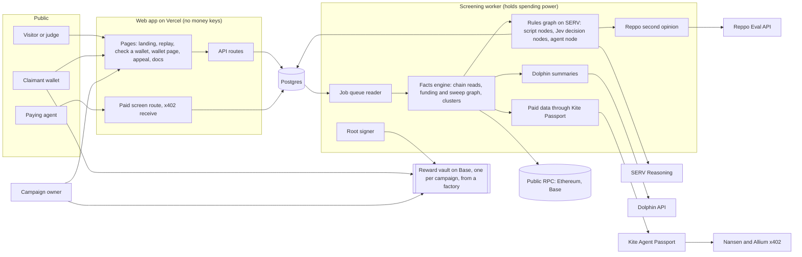
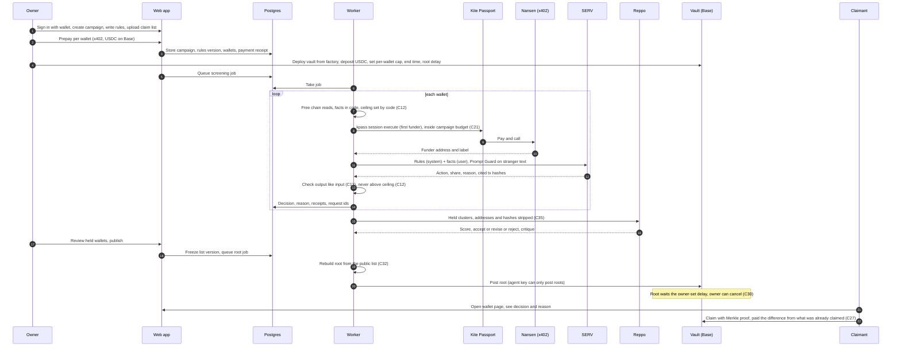
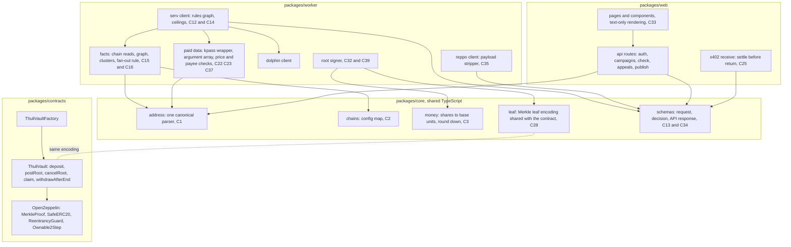

# Thuli architecture

Thuli is Tamil for "a drop": every drop of an airdrop lands in a real hand.

Picked 27 Oct 2026: a screening service with an immutable reward vault on Base (PLAN.md, Option 2). The numbered
rules (C1 to C45) are in docs/security/threat-model.md. This file grows the interface section (addresses, ABI, the
exact reads and writes the UI makes) as the backend lands.

## 1. System overview

## 2. Main sequence: one campaign, from upload to a claim

## 3. Module dependency graph

## 4. Interface for the frontend

Filled in at M7 when the vault is deployed and verified: addresses, ABI, and every read and write the UI makes.
