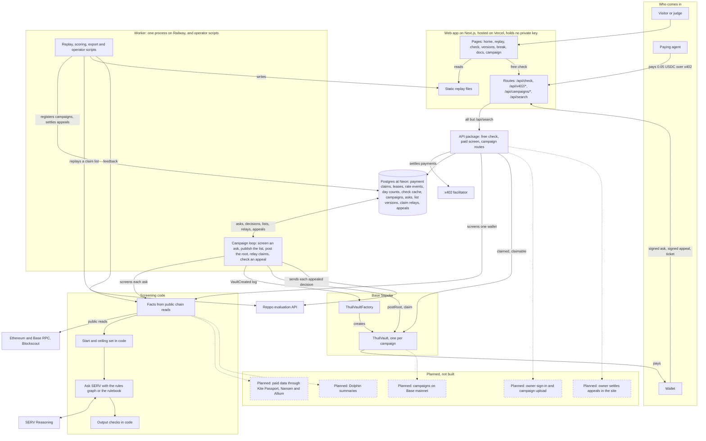
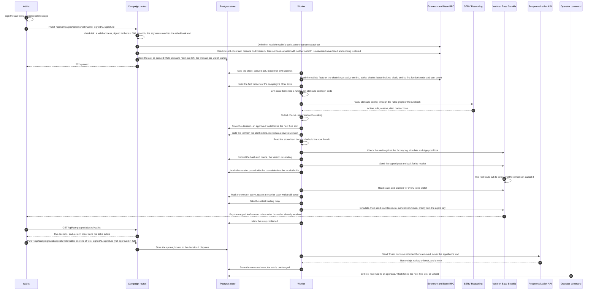
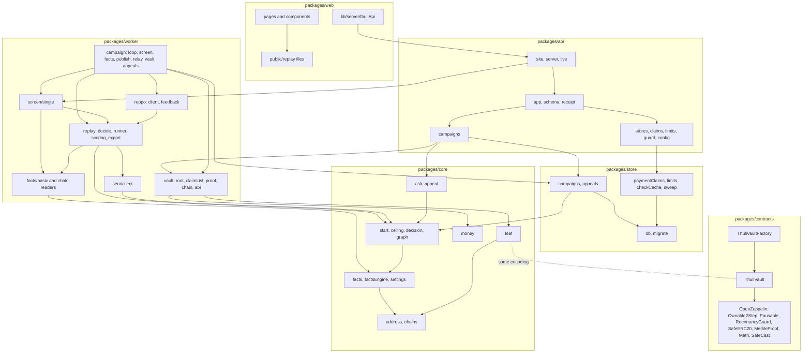

# Thuli

Thuli screens an airdrop or reward claim list for farm wallets, gives a reason for every wallet it holds back, and pays the approved wallets from a vault on Base where Thuli's own key can post a list and nothing else.

Thuli is Tamil for "a drop": every drop of an airdrop should land in a real hand.

| 99.03% | 1.00% (95% interval 0.61% to 1.64%) | 0.05 cents |
| --- | --- | --- |
| of the labelled farm wallets held in the ROBO replay | of Hop control wallets held by mistake, current rulebook | of SERV credit per wallet screened, realised |

Each number has its limits stated in [What was measured](#what-was-measured).

Built for the OpenServ SERV hackathon. SERV Reasoning applies the rulebook, Reppo's judges scored a sample of the decisions, and the vault runs on Base. The campaign and its vaults are on Base Sepolia with test USDC, which has no value. Two things have run with real USDC on Base mainnet: one small proof vault, and one 5 cent payment to the paid API. The site is live at [thuli-drop.vercel.app](https://thuli-drop.vercel.app), and each claim below also comes with a command you can run on a fresh clone.

[Live app](https://thuli-drop.vercel.app) | [Docs](https://thuli-drop.vercel.app/docs) (the `/docs` route of the app, source in [content/docs](packages/web/content/docs/index.mdx)) | [Architecture](ARCHITECTURE.md) | [Threat model](docs/security/threat-model.md) | [Licence](LICENSE)

## Deployments

Base Sepolia is Base's public test network, chain id `84532`. On Base mainnet, chain id `8453`, the factory is deployed and one small vault was run from start to end with real USDC as a proof, described below the table. The public campaign and every other address in this file stay on Base Sepolia with test money. The deploy script deploys to Base only when it is given both `--network base` and `--real-money`.

| Network | Contract | Address | Verified source |
| --- | --- | --- | --- |
| Base mainnet | ThuliVaultFactory | [`0x1d9b8CD9A5aF33287Bb96862d9BB0f563DC402De`](https://basescan.org/address/0x1d9b8cd9a5af33287bb96862d9bb0f563dc402de) | [Basescan](https://basescan.org/address/0x1d9b8cd9a5af33287bb96862d9bb0f563dc402de#code) |
| Base mainnet | ThuliVault, the mainnet proof vault | [`0x52e9F0D7b48a7bbAf5700433810c41C96CfBC40C`](https://basescan.org/address/0x52e9F0D7b48a7bbAf5700433810c41C96CfBC40C) | [Basescan](https://basescan.org/address/0x52e9F0D7b48a7bbAf5700433810c41C96CfBC40C#code) |
| Base Sepolia | ThuliVaultFactory | [`0xbD2c20D2A068fe6D5052efcA910D1Cba44638B56`](https://sepolia.basescan.org/address/0xbD2c20D2A068fe6D5052efcA910D1Cba44638B56) | [Blockscout](https://base-sepolia.blockscout.com/address/0xbd2c20d2a068fe6d5052efca910d1cba44638b56), [Basescan](https://sepolia.basescan.org/address/0xbd2c20d2a068fe6d5052efca910d1cba44638b56#code) |
| Base Sepolia | ThuliVault, the proof vault | [`0xAdb8aD5A8BC359fF17D81DBe41833bB6b26B2034`](https://sepolia.basescan.org/address/0xAdb8aD5A8BC359fF17D81DBe41833bB6b26B2034) | [Basescan](https://sepolia.basescan.org/address/0xAdb8aD5A8BC359fF17D81DBe41833bB6b26B2034#code) |
| Base Sepolia | ThuliVault, the demo campaign's vault | [`0x863342D22557De5E7f093F9351797291b18329CA`](https://sepolia.basescan.org/address/0x863342D22557De5E7f093F9351797291b18329CA) | [Basescan](https://sepolia.basescan.org/address/0x863342D22557De5E7f093F9351797291b18329CA#code) |

The Base mainnet factory was deployed in transaction [`0x2f00...bff3`](https://basescan.org/tx/0x2f0088506ef05f2a9c435b9fc141ad60c399380126d4c6670f5bcaf1dfe9bff3) in block `56121245`, and its record is [`base.json`](packages/contracts/deployments/base.json). Its runtime code is byte for byte the Base Sepolia factory's, the same 9,415 bytes when read from both chains, and its source is verified on Basescan.

Realised, with real USDC on Base mainnet: on 12 November 2026 that factory made one vault with a cap of 1 USDC, a deposit of 2 USDC and a one-hour delay. Thuli's worker key posted a list of one wallet. When the hour was over the worker submitted the claim and the vault paid that wallet exactly 1 USDC ([the claim](https://basescan.org/tx/0x6cbeb31cbeddd5ba6b2c98463d2a1d3dfa679fef0774a3f3683faf5dc4bb3d31)), with the worker paying the gas. A static call of the claim for a wallet that is not on the list, with the paid wallet's proof, reverts with `InvalidProof`. After the vault ended, the owner took back the 1 USDC that was left ([the withdrawal](https://basescan.org/tx/0x0f8c55a0ab1c74efa7d5462feeb9423208d85e45c04538553c7cc1e648422ba6)). The run is recorded in [`base-proof.json`](packages/contracts/deployments/base-proof.json), and `npm run prove:vault -- verify --network base --real-money` checks that record against Base in 17 checks. It reads the factory's logs, so it needs a Base RPC that serves log queries; Base's own public endpoint refuses them. What this proof does not show: a campaign on mainnet. It is one vault, one list and one wallet.

The Base Sepolia factory was deployed in block `57247894` (record: [`base-sepolia.json`](packages/contracts/deployments/base-sepolia.json)). It made the proof vault in block `57248098`, and the run that used it is recorded in [`base-sepolia-proof.json`](packages/contracts/deployments/base-sepolia-proof.json). The proof vault pays Base Sepolia test USDC (`0x036CbD53842c5426634e7929541eC2318f3dCF7e`), caps each wallet at 1 USDC, holds 2 USDC and delays every list by one hour. The Base Sepolia factory's source is verified on Blockscout and Basescan, and the proof vault's on Basescan. The vault's source is also in the repository: [`ThuliVault.sol`](packages/contracts/src/ThuliVault.sol). Basescan shows a bot check to scripts, so those links are for a browser. `npm run vault:verify` verifies contracts on Basescan and needs an explorer API key, and `npm run vault:verify -- --network base` does the same for the mainnet factory (see the commands table). You can check the proof record against the chain yourself: step 3 of the judge path below.

## What Thuli does

Reward drops attract farmers: one operator running many wallets to collect many rewards. In the ROBO airdrop on Ethereum, the 11,282 wallets (in 482 families) on a farm list published by the analytics firm Bitquery took 87.43% of all the ROBO that was claimed. A project that pays without screening pays for that.

Thuli turns each wallet into one of four outcomes: paid in full, cut to a partial reward, held for review, or excluded. A hold means a person reviews the wallet. It is an assessment of on-chain behaviour, not a verdict that the wallet is a farm. Four steps decide it:

1. Plain code reads public chain data for the wallet at a fixed point in time (Ethereum for the replay, the free check and the paid check; Ethereum or Base mainnet for a campaign ask) and works out facts: its age, how many transactions it has sent, whether it is a contract, who first funded it, and whether other claim wallets share that funder or sweep into the same collector address.
2. Nine fixed checks in code (A1 to A9) set a start and a ceiling. The ceiling is the most generous outcome the facts allow, and it is set before any model runs.
3. SERV Reasoning, OpenServ's model service, reads the facts and a written rulebook ([`thuli-rulebook.md`](packages/rulebook/thuli-rulebook.md)) and returns an outcome, a reason of at most 280 characters and the transactions it cites. It can lower a wallet to a hold. It can never go above the ceiling.
4. Code checks the answer as if a stranger wrote it: a fixed shape, plain text only, and every cited transaction must be one Thuli itself fetched for that wallet. A failed check becomes a hold with the cause in words. Doubt means hold.

Approved wallets go on a claim list. The list becomes one short fingerprint, a Merkle root, posted to the project's own vault on Base (today Base Sepolia, with test USDC). The root waits out a delay the project chose, from 1 hour to 30 days, during which the project can cancel it. Then each approved wallet is paid, and Thuli's worker can submit the claim so the wallet pays no gas.

Compared with a bare list of addresses or a bare score:

| | A bare blocklist or one score | Thuli |
| --- | --- | --- |
| A reason for every wallet | A yes or no, or a number | A rule code, a plain-text reason and the transactions it cites, for each wallet (open `/replay`) |
| A ceiling the model cannot exceed | Not part of a list or a score | Set in code before the model runs. The final outcome is the less generous of the model's answer and the ceiling |
| An outside check | Not part of a list or a score | Reppo's judges scored 49 of Thuli's decisions, blocked 11 of them, and one rule changed because of it |
| Money the screener cannot take | Not part of a list or a score | In the vault, Thuli's key can post a list and cannot withdraw, cancel, pause or change anything else. The owner can cancel any list during its delay. The vault page states the loss if that key is stolen |
| A public replay with the misses shown | Not part of a list or a score | Every wallet of a past airdrop, decided and explained, with the false holds measured on a control group and a limits page that lists what Thuli does not catch |

The middle column describes a bare list of addresses or a bare number, not any named product.

## What was measured

These are runs on past data and one cost. None of them is a promise about your campaign.

| What was measured | Result | What it does not show |
| --- | --- | --- |
| ROBO replay: farm-list wallets held. All 35,323 wallets that claimed the airdrop on Ethereum (35,402 claims), screened with chain data from before the first claim | 11,173 of 11,282 held, 99.03% | The farm list is one firm's analysis (Bitquery), built from where the tokens moved months after the claim. The run tests whether claim-time facts find wallets later shown to move together. It does not prove that every farmer is on the list. |
| Hop control sample: wallets held by mistake under the current rulebook. A random 1,500 of the 21,174 wallets Hop Protocol kept in its 2022 airdrop and never named in a candidate group | 15 of 1,500 held, 1.00%, 95% interval 0.61% to 1.64%. Before the rulebook change: 38 of 1,500, 2.53%, interval 1.85% to 3.46% | A wallet Hop kept is not proved to be a real person, and the rate comes from a sample. Read it as an estimate. |
| Hop, code only: the fixed checks with no model, on the probably-real Hop wallets that have Ethereum history | 119 of 20,420 held, 0.58%, 95% interval 0.49% to 0.70% | It scores the code's starting point, not the final decisions, so it is a different number from the 1.00% above. |
| ROBO replay: wallets not on the farm list that were held or excluded | 283 held and 66 excluded, 349 of 24,041 | An upper bound on false holds, not a measured rate. The farm list may miss farmers. |
| Realised: SERV credit spent on the whole ROBO run | $17.51, about 0.05 cents a wallet | SERV credit only. Reppo's evaluation credit and any server cost are not counted. |
| Unrealised, replay only: money held back from the farm list | $12,007,754 of $12,064,999 claimed, with ROBO at the claim-day price of $0.0419 | Nothing was sold or paid, and a real sale would move the price. |
| Cost of the rulebook change: share held in a sample of 500 wallets Hop removed whose start was A8 or A9 | 11.20% before, 3.00% after | A cost, not a gain: the change gave up some correct holds. |
| Repeatability: 30 replay wallets (10 paid in full, 10 cut to partial, 10 held by the model), each screened 5 more times from scratch on 11 November 2026 | 30 of 30 wallets got one outcome on all 5 runs, 95% interval 88.65% to 100%. 150 of 150 runs matched the wallet's other runs, 97.50% to 100%. 0 runs went above the code's ceiling. 110 of 150 runs matched the stored replay decision, 73.33%, 65.74% to 79.76% | 30 wallets is a small sample, so the intervals are wide, and the same answer twice is not the same as the right answer. The 40 runs that did not match the stored decision are all in the model-held group, where 8 of 10 wallets got a reward on every fresh run: their stored holds came from one refused answer, a flaw in the replay itself. The campaign worker now asks again, twice, before it stores a hold of that kind. The run cost 249 SERV calls. |

A 95% interval is the range the true rate probably falls in.

### The feedback loop

Reppo's outside judges read 49 of Thuli's own decisions, chosen by group and not at random, with every address, hash and amount removed. They blocked 11, all holds the model had made because a funder was shared with other wallets. One rule changed: version 2 of the rulebook says a shared funder alone cannot hold a wallet, because how many wallets a funder paid is a count and not a trail. Both versions were then scored on the same stored model replies with no model called, so the only difference is that rule: version 2 no longer makes 10 of the 11 blocked decisions, false holds on the Hop sample fell as shown in the table, and the 99.03% catch rate did not change. No Reppo verdict exists yet on a version 2 decision.

## Features

Everything on chain below is Base Sepolia with test money. Two things ran on Base mainnet with real USDC: the factory with one proof vault that paid 1 USDC, in the Deployments section, and one 5 cent payment to the paid check, described with the paid route below.

For a project that is about to pay rewards:

- Screen a list. The replay screens a whole claim list at once, and a live campaign screens each wallet's ask as it arrives. A project cannot yet upload its own list through a form; it registers a campaign with two commands (see [What is not built yet](#what-is-not-built-yet)).
- A vault only approved wallets can claim from. Each campaign gets its own vault from the factory. The project funds it. A wallet is paid its approved total minus what it already received, never above the per-wallet cap fixed at creation, and the total paid never passes the deposit.
- A cancel window. Every new list waits the delay the project set. In that time the project can cancel the list, replace Thuli's key (which also drops a waiting list) or pause the vault. The project withdraws what is left only after the end.
- A door that keeps out empty wallets and floods. A wallet that has sent no transaction and has a zero balance on Ethereum, and the same on Base mainnet, is turned away before anything is stored, so it takes no slot and costs no model call. A campaign also stops taking asks when its slots are gone, when 200 asks wait undecided, or when it reaches a lifetime cap of the larger of 1,000 asks and 100 for each slot. The worker runs at most 2,000 model screenings a day across all campaigns.
- Appeals the owner settles. The outside check on an appeal is advice, and only the owner's settle changes an outcome. Owner sign-in is not built, so today an operator's command does it: `npm run appeal:list` shows a campaign's appeals, `npm run appeal:settle` settles one as reversed or upheld, and `npm run appeal:export` writes the checked appeals to a private file as input for the next rulebook change. A reversal turns the ask into an approval and gives it the next free slot, if one is left.

For a wallet:

- A free check. Paste any Ethereum address at `/check`, or call `POST /api/check`. No sign-in and no payment, up to 5 new checks an hour for each visitor.
- A reason. Every decision shows the outcome, the rule, a plain-text reason, the transactions it cites and the list of facts the screening did not measure.
- A live campaign with no gas. A wallet signs a four-line text message, which costs nothing and moves nothing. Thuli screens it in public. If it is approved it takes a slot, and after the vault's delay the worker submits the claim from its own key and pays the gas. On Base Sepolia with test USDC. A wallet that has never been used on Ethereum or on Base is told so at the door, and nothing is stored.
- Screened on the chain where the wallet is older. A campaign ask is read on Ethereum or on Base mainnet, whichever the wallet was active on first, and the decision says which. A wallet used only on Base is screened on its Base history. This needs the worker's two RPC endpoints to serve old state and traces, which it checks at start. With an endpoint that answers and serves neither, it reads Ethereum only, says so in its log, and decides only a wallet that two plain calls show was never used on Base. An endpoint that answers nothing at start, or answers for another chain, stops the worker instead. The two free public endpoints in `.env.example` serve no history, so a fresh clone runs in the Ethereum-only mode. `npm run campaign:screen -- --wallets <address>` shows the chain and the decision for any wallet without storing anything.
- An appeal. A wallet that was held, excluded, cut to a partial reward or whose screening could not finish can file one appeal per campaign: one line of text, signed with the wallet like the ask, with no gas. Thuli's own decision for that wallet, with the parts that identify it removed, goes to Reppo for an outside check. The wallet's own words go to no model and appear on no public page. The route Reppo gives (ship, review, block or unreadable) and a short note are shown beside the decision. The check is advice. This is built and covered by tests, and two appeals have been run live, both against the same test wallet's partial decision: Reppo answered `review` on one and `ship` on the other, and the owner upheld both (see [A local run of the live campaign](#a-local-run-of-the-live-campaign)).

For another agent or a developer:

- A paid API over x402, a standard that puts payment inside an HTTP request. `POST /api/x402/screen` costs $0.05 in USDC (exactly `50000` base units) for one wallet. The payment settles before the screening runs and is charged once, and for 24 hours the same payment header for the same wallet returns the stored result at no charge. It has taken one real payment, 5 cents of USDC on Base mainnet ([transaction](https://basescan.org/tx/0xd55cd1ba2f1fcbc639a0d5d54ecf60fc9492226232f952da2d8af87bfcba47d4)), after a full run on Base Sepolia with test USDC.
- Public replay files under [`packages/web/public/replay`](packages/web/public/replay): the summary, one entry per claim wallet, one file per linked family, the rulebook scorecard, the Hop control numbers and the repeatability run. No file holds a raw model reply.
- A page of ten live attacks at `/break`: five simulated calls against the proof vault, four requests to the site's own routes, and one check that a reason is shown as plain text.

### A local run of the live campaign

On 11 November 2026 the site and the worker ran on one machine against Base Sepolia with test USDC. A wallet with some history asked through the site, was approved in full and took slot 1. The worker posted list 1 in [this transaction](https://sepolia.basescan.org/tx/0x9ab3fc2af5e2eb1597cb781d5eb8d4da265b14977234e18b2aa66adb6c27e915) to the campaign's vault, [`0x866eDed69E7800d19c8D73f7Edf5c54081f8BA65`](https://sepolia.basescan.org/address/0x866eDed69E7800d19c8D73f7Edf5c54081f8BA65). When the vault's hour was over, the worker submitted [the claim](https://sepolia.basescan.org/tx/0x27f1dee59482b1c12daa7937f5a56098efb39c0a48fcb9c7f1b8bbd0f4ca98f7), which paid that wallet 0.5 test USDC. A wallet that had never been used was held. A paid call through the built site was charged once and its stored result fetched again ([transaction](https://sepolia.basescan.org/tx/0x4dd9f6a26f42f72e562203ea9a9ac4cbcb27753ca580a4778ca7fa225a3574a1)). This was a local run against a public test network, not a hosted deployment and not a public campaign, and the vault is not in the Deployments table.

On 13 November 2026 one appeal ran end to end on the same local setup. A test wallet one day old on Base asked, was cut to a partial reward under rule A8 and took a slot. It filed a signed appeal, and the worker sent Thuli's decision to Reppo once, as evaluation `cmwegxukf000508l98c92l3va`. The check finished 86 seconds later with the route `review`: Reppo's note says its judges disagreed, one scoring the decision 60 and one 100. Realised: 440 Reppo credits, 22 cents, charged once. The owner upheld the decision with `npm run appeal:settle`. The same day a second appeal ran on this site's demo campaign, with the hosted database and the worker on its host. The same test wallet had been cut to a partial reward under A8 there too, and it appealed. The worker sent the decision once, as evaluation `cmwezv7mt000007lbw9ii5xzp`, and 59 seconds later Reppo answered `ship`: its judges agreed with Thuli, with a score of 97. Realised: another 440 credits, 22 cents, charged once. The owner upheld the decision. What these two runs do not show: a `block` route, a reversal, or any of the failure paths, which have run only in tests.

The public demo campaign is "Thuli demo drop", id `thuli-demo`: 24 slots of 0.5 test USDC, paid from the demo vault in the Deployments table. It runs on a hosted Postgres database and a worker process on its own host. On 13 November 2026 the hosted parts were checked together before the site went up. Thuli's own test wallet, which is also the demo campaign's owner, signed an ask and sent it through a production build of the site on one machine, set up exactly as the hosted site is. The ask was stored in the hosted database. The worker on its host read the wallet's history on Base, cut it to a partial reward under rule A8 (one day old, six transactions sent) and gave it slot 1, twelve seconds after the ask was stored. One second later it posted list 1 to the demo vault in [this transaction](https://sepolia.basescan.org/tx/0x708517c831f4335ac375963e10f1f7a8fa0ba826d92063981173b9ede0091f2d). What this does not show: an ask sent through the hosted site itself.

On 12 November 2026 the two-chain read was run live with `npm run campaign:screen` on three wallets, one model screening each. A wallet with history only on Base was read on Base and approved in full (45 days old, 40 transactions sent). A wallet with history only on Ethereum was read on Ethereum and cut to a partial reward (329 days old, 4 sent). A wallet with both was read on Base, where it is older (939 days against 895 on Ethereum), and approved in full.

The reader behind that works with plain RPC calls and no explorer. It was checked on Ethereum against the explorer with `npm run history:compare`: on the 29 of 31 wallets whose whole history the explorer could serve, both gave the same age, sent count, account type, first funder and funding transaction. For the other 2 the explorer's own internal-transfer list failed, and the reader matched the explorer's shorter read. What this does not show: on Base there is no second source here to compare against, and no false-hold rate has been measured on Base history.

## How it fits together

The system as it runs today. Solid lines are built. Every dashed line leads into the planned box, and nothing in that box is built.



One wallet from its signed ask to its payout, as the API, the store and the worker do it. Every step is in the code, and the worker runs as one process on a host.



The packages and their main modules. An arrow points from a module to one it imports. The one dashed line is not an import: core's leaf and the vault hash a claim the same way, so a list built in TypeScript proves on chain.



## The two-minute judge path

The fastest way is the live site, [thuli-drop.vercel.app](https://thuli-drop.vercel.app), with nothing to install:

1. Click "Watch the replay". Open a family, then a wallet, and read its reason.
2. Click "Check a wallet" and paste any Ethereum address. It is free. A wallet nobody has checked before takes one model call.
3. Click "Campaign", connect a wallet and click "Sign and ask". It costs nothing and moves no money of yours. Your decision arrives on the board.
4. Click "Versions" to see both rulebook versions scored the same way, and "Break it" to run ten attacks yourself.

The rest of this section shows the same things on your own machine. It needs no key and no wallet. You need git and Node 26 or newer. The output below is from a fresh clone on 14 November 2026.

1. Clone and install.

   ```bash
   git clone <repository-url> thuli
   cd thuli
   npm install
   ```

   Expect `added 603 packages, and audited 615 packages in 35s` and exit code 0. npm also prints a dependency audit summary (7 findings: one advisory in `uuid` and one in a nested `zod`, counted along each path) and a note about esbuild's install script. Neither stops the install, and [the dependency audit page](docs/security/dependency-audit.md) says why neither advisory can be reached from Thuli's code and why no safe upgrade exists yet.

2. Run the tests.

   ```bash
   npx vitest run
   ```

   Expect:

   ```text
    Test Files  75 passed (75)
         Tests  2113 passed | 104 skipped (2217)
   ```

   It takes about 80 seconds. The 104 skipped tests need things a fresh clone does not have: a real Postgres for 97 of them (point `STORE_TEST_URL` at an empty scratch database; the same tests already run on an in-memory Postgres), the compiled contracts for 1 (the contract tests create them when they compile), and stored replay data that is not in the repository for 6. This run does not cover the Solidity contracts. Those have their own tests in [Tests and gas](#tests-and-gas).

3. Check the vault proof against Base Sepolia.

   ```bash
   npm run prove:vault -- verify
   ```

   This reads the committed proof record and checks it against the chain, line by line. It sends nothing and loads no key. Expect 14 `pass` lines and exit code 0:

   ```text
   Checking packages/contracts/deployments/base-sepolia-proof.json against Base Sepolia at block 57463595:
     pass  factory                  the record names the factory in base-sepolia.json, 0xbD2c20D2A068fe6D5052efcA910D1Cba44638B56
     pass  createVault transaction  0xda041583c1c4170d470e537c7d36f41fc1912b398758a3612d492960e45bd13c succeeded in block 57248098, ...
     ...
     pass  claimed(paid)            claimed(0xFE2B7D1707A725E2D8D6040506D26a28A98a5CdD) is 1000000, at least the recorded 1000000
     pass  claimed(refused)         claimed(0xb2864c5C992f22E6d8A6A47945c0E897C440DAf7) is 0
   Not checked: that the refused wallet's claim reverts. That needs the private claim list behind the root, so only the record phase repeats it.
   All 14 checks pass. The vault on Basescan: https://sepolia.basescan.org/address/0xAdb8aD5A8BC359fF17D81DBe41833bB6b26B2034
   ```

   The block number will be later on your run. The command uses Base's public RPC `https://sepolia.base.org`, which is rate limited. If it refuses, set `BASE_SEPOLIA_RPC_URL` to an https endpoint of your own. What this shows: one approved wallet was paid exactly 1 test USDC, and a wallet left off the list has been paid nothing. What it does not show: that the left-off wallet's claim reverts. The `/break` page runs that refusal for you.

4. Open the site on your machine and look at the replay, the versions page and the break page.

   ```bash
   npm run web:dev
   ```

   Open `http://localhost:3000`. These three pages need no key.

   - `/replay` has the heading "The ROBO airdrop, replayed." and the line "35,323 wallets claimed this airdrop. This is what Thuli's rulebook v2 decides for each one, using only chain data from before the first claim. No money moved." Under it are four counts: Held for review 11,456, Excluded 66, Cut to a partial reward 22,867, Paid in full 934. Open `/replay?wallet=0x041f77015fe51c51ae49a7f2f3ff86c641fa190a` to read one wallet: it is held on rule A4 as one of 19 linked wallets, with its reason and the transaction the reason cites.
   - `/versions` has the heading "Every rulebook version, scored the same way." and a scorecard: farm wallets caught 11,173 of 11,282 under both versions, real users held by mistake 38 of 1,500 under version 1 and 15 of 1,500 under version 2, and blocked decisions no longer made 0 of 11 and 10 of 11. Further down is a section headed "The same wallet, the same answer.", the repeatability run: 30 of 30 wallets with one outcome every run and 150 of 150 runs matching the wallet's other runs.
   - `/break` has the heading "Attack it yourself." and a button "Run all 10 attacks". The five vault attacks run as simulated calls from your browser against the proof vault, through Base Sepolia's public RPC, and the markup check runs in the page. Above the rows, a line says whether the list root rebuilt in your browser matches the vault's active root. Each attack should read as refused, and the tally counts only the rows that ran. The four rows that attack the site's own routes need the site's settings from `.env.web.example`, and show as not run without them.

   `npm run web:build` builds the same site for production and finishes with exit code 0 and 33 pages.

Optional steps that need a tool or a test key:

- Contract tests. Install Foundry from [getfoundry.sh](https://getfoundry.sh), run `npm install --prefix packages/contracts`, then `npm run contracts:test`. Expect `77 tests passed, 0 failed, 2 skipped (79 total tests)`.
- A live check of any wallet at `/check`. It calls SERV, so it needs a SERV API key: make one under "API keys" at [console.openserv.ai](https://console.openserv.ai). Copy `.env.web.example` to `packages/web/.env.local` and fill the values listed in the Quick start. It shows a decision, a rule, a reason and the transactions behind it within about two minutes.
- The paid route, `npm run prove:paid`. It needs the SERV values in `.env.api`, and a throwaway test key in `.env.payer` as `PAYER_PRIVATE_KEY` (make one with Foundry's `cast wallet new`) holding at least 5 cents of Base Sepolia test USDC from [Circle's faucet](https://faucet.circle.com). With `X402_NETWORK=base` and the Coinbase keys in `.env.api`, the same command pays 5 cents of real USDC on Base. It pays for one screening, then fetches the stored result 10 more times with the same payment header and checks that each copy is identical. It also checks that a fresh header that never settled buys no result, and that exactly 5 cents left the wallet, so the payment was charged once.
- The whole campaign path on a local copy of Base Sepolia, `npm run rehearse:campaign`. It needs Foundry's `anvil` and the SERV, Ethereum and Base Sepolia values in `.env`. Six throwaway keys ask, live SERV screens them, the approved wallets take three slots and the worker submits their claims. Two more campaigns on the same copy show the worker recovering from a post it never recorded, a publish that stalls, a pause across a list's activation and a dropped transaction. It prints `pass` or `FAIL` for each check and sends no transaction to a public network.

## Quick start

Prerequisites:

- Node.js 26 or newer (`engines` in `package.json`), with npm. The output in this file is from Node 26.7.0 and npm 11.19.0.
- Foundry, only for the contract tests and for `rehearse:campaign`. The output in this file is from forge 1.8.6.
- A Postgres you can reach, only for `npm run db:migrate`, the worker and `campaign:create --write`. The tests, the site and the standalone API need none.
- A SERV API key, for anything that screens a wallet live.

Install:

```bash
npm install
npm install --prefix packages/contracts
```

The second line is needed only for the contract tests.

Environment files. Each is a file you create, and none is committed. Only names are listed here.

| Create this file | Copy it from | Used by | Names that matter |
| --- | --- | --- | --- |
| `.env` | `.env.example` | the replay, scoring, repeatability, vault proof, campaign, appeal and worker scripts, and `db:migrate` | `SERV_API_KEY`, `SERV_BASE_URL`, `SERV_GRAPH_ID`, `ETH_RPC_URL`, `BLOCKSCOUT_ETH_API` for screening. `BASE_SEPOLIA_RPC_URL` for vault commands (the public endpoint is used when it is empty). `DATABASE_URL` for the database. `WORKER_PRIVATE_KEY` and `PAYER_PRIVATE_KEY` for sending Base Sepolia transactions, test keys only. `EXPLORER_API_KEY` (an Etherscan API key) for `vault:deploy` and `vault:verify`. `REPPO_API_KEY` for Reppo feedback runs, and for the worker's appeal checks (without it, appeals wait in the queue). For the Base mainnet flags, `BASE_RPC_URL` and the owner key `PAYER_PRIVATE_KEY`, plus `WORKER_PRIVATE_KEY` for the proof's agent steps |
| `.env.api` | `.env.api.example` | `npm run api:dev`, the standalone paid and free API | `X402_NETWORK`, `PAYTO_ADDRESS_TESTNET` (an address, never a key), `SERV_API_KEY`, `SERV_BASE_URL`, `SERV_GRAPH_ID`, `ETH_RPC_URL`, `BLOCKSCOUT_ETH_API`, `DATABASE_URL`, `TRUSTED_CLIENT_HEADER`, `PORT`. On Base mainnet only: `CDP_API_KEY_ID`, `CDP_API_KEY_SECRET`, `PUBLIC_ORIGIN`, `BASE_RPC_URL`. It refuses to start if any name ending in `PRIVATE_KEY` is set |
| `packages/web/.env.local` | `.env.web.example` | `npm run web:dev`, and the site's `/api/check`, `/api/x402` and `/api/campaigns` routes | the same payment, SERV and Ethereum names, plus `DEMO_CAMPAIGN_ID` (the campaign the `/campaign` page shows) and `NEXT_PUBLIC_WALLETCONNECT_PROJECT_ID`. Never a name ending in `PRIVATE_KEY` |
| `.env.payer` | none, create it | `npm run prove:paid`, `npm run vault:create` | `PAYER_PRIVATE_KEY`, a test wallet key |

The replay, decide, feedback and scoring scripts, `prove:slice`, `appeal:demo` and `vault:deploy` load `.env` as required, so they stop at once with `node: .env: not found` (exit code 9) until you create it. `prove:vault`, `db:migrate`, `worker`, `vault:create`, `vault:verify`, `campaign:create`, `campaign:requeue`, `appeal:list`, `appeal:settle`, `appeal:export`, `consistency` and `rehearse:campaign` carry on without it and stop on their own message about the missing setting (exit code 1 or 2). `api:dev` stops the same way without `.env.api`, and `prove:paid` without `.env.api` and `.env.payer`.

`X402_NETWORK` has no default, so testnet is a choice you make: `base-sepolia` for test USDC or `base` for real USDC. The paid route has been run on both.

The local database. `npm run db:migrate` needs `DATABASE_URL` set, as a `postgres://` or `postgresql://` connection string, in `.env` or in your shell. It applies the SQL files in [`packages/store/migrations`](packages/store/migrations), prints what it applied, and is safe to run again. With `DATABASE_URL` unset it stops with exit code 2 and the line `DATABASE_URL is not set. Put a postgres:// connection string in .env.` The site alone needs no database locally: leave `DATABASE_URL` empty and it runs an in-process one whose contents are lost on restart.

Commands, all from the root `package.json`:

| Command | What it does |
| --- | --- |
| `npm test` | Runs `vitest run`: every test under `packages/*/test`. |
| `npm run test:db` | Runs the store and API tests one file at a time on an in-memory Postgres. Set `STORE_TEST_URL` to the address of a Postgres and the same tests also run there, which empties the tables they test, so give it an empty scratch database. Without it, 91 of 427 tests skip. |
| `npm run typecheck` | Runs the TypeScript compiler over core, worker, API, store and web. Writes no files. |
| `npm run contracts:test` | Runs `forge test --root packages/contracts`. Needs Foundry. Without a Base RPC, 77 pass and 2 skip. With `BASE_RPC_URL` set, 79 pass. |
| `npm run contracts:lint` | Runs solhint over the Solidity. Needs `npm install --prefix packages/contracts`. |
| `npm run web:dev` | Starts the site on `http://localhost:3000`. |
| `npm run web:build` | Builds the site for production. |
| `npm run api:dev` | Starts the standalone paid and free API on port 8787, or on `PORT`. Needs `.env.api`. |
| `npm run prove:vault -- verify` | Checks the committed vault proof against Base Sepolia, 14 checks, no key. The other Base Sepolia phases (`setup`, `claim`, `record`) need two test keys and are not for strangers. |
| `npm run prove:vault -- <phase> --network base --real-money` | The Base mainnet proof: one small run fixed in code (a 1 USDC cap and a 2 USDC deposit) in six phases, `create`, `post`, `claim`, `withdraw`, `record` and `verify`. Each phase signs nothing unless you add `--send`, and it needs `BASE_RPC_URL`. It was run on Base mainnet on 12 November 2026, and `verify` checks the committed record `base-proof.json` in 17 checks. `verify` needs a Base RPC that serves log queries. `--fork` runs every phase against a local fork instead. |
| `npm run prove:paid` | Pays for one screening of one wallet, fetches the stored result 10 more times with the same payment header and checks that each copy is identical, checks that a fresh header that never settled buys no result, and checks that exactly 5 cents left the wallet. Needs a funded test key and the SERV values. |
| `npm run vault:deploy` | Deploys the factory to Base Sepolia and records it. Needs the worker key and an explorer key. With `--network base --real-money` it targets Base mainnet instead: without `--send` it simulates and signs nothing, and with `--send` it deploys and writes `base.json`. The mainnet path needs `BASE_RPC_URL` and the owner key. |
| `npm run vault:verify` | Verifies the factory and the proof vault on Basescan through the Etherscan API, plus any vault made by a `createVault` transaction you name with `--vault-tx`. `-- --network base` does the Base mainnet factory. Sends no transaction. Needs Foundry and an explorer API key (`EXPLORER_API_KEY`); it refuses without one, with exit code 1. |
| `npm run vault:create` | Makes and funds one campaign vault from the committed factory. Without `--send` it prints the plan and signs nothing. |
| `npm run campaign:create` | Registers a campaign from its vault's creation transaction. It needs `--agent`, the key the vault names as its agent, and it refuses a vault that holds less than the reward times the slots. Without `--write` it stores nothing. It signs nothing. |
| `npm run campaign:screen -- --wallets <address>` | Screens up to 6 wallets the way a campaign ask is screened, in a throwaway campaign in memory: prints the chain each was read on, the decision, the reason and the facts. Stores nothing, signs nothing, sends nothing. One model screening per wallet. Needs the SERV values and the two RPC endpoints. |
| `npm run history:compare -- --wallets <file or list>` | Read-only check of the RPC history reader against the explorer's whole history on Ethereum: the facts each gives for every wallet, side by side, and every difference. Exits 1 on any difference or unread wallet. |
| `npm run campaign:requeue` | Puts one failed ask back in the queue after an outage, so the worker screens it again from the start. Without `--write` it only says what it would do. Any ask that has not failed is refused, and so is an ask that has an appeal. |
| `npm run worker` | Runs the campaign worker: screens asks, posts lists to the vault, submits claims, and sends appeals to the outside check when `REPPO_API_KEY` is set. `-- --once` runs one pass and exits. Runs as one process, on Base Sepolia. |
| `npm run rehearse:campaign` | Runs the worker end to end on a local fork of Base Sepolia, with failure cases. Needs `anvil` and live SERV. |
| `npm run appeal:list` | Prints one campaign's appeals for the operator, with each appeal's text, the outside check and the outcome. The only place an appeal's text is shown. Changes nothing. |
| `npm run appeal:settle` | Settles one appeal as `reversed` or `upheld`, the way an owner would. Without `--write` it prints the store's answer and writes nothing. A reversal makes the ask an approval and gives it the next free slot. |
| `npm run appeal:export` | Writes a campaign's checked appeals, with Reppo's whole verdict, to a private file as input for the next rulebook change. The scorecard does not score appeals yet. |
| `npm run consistency` | Asks SERV about the same wallets again and writes the repeatability result to `packages/web/public/replay/consistency.json`. Spends SERV credit and needs the stored replay data. |
| `npm run db:migrate` | Brings the Postgres at `DATABASE_URL` up to date. |
| `npm run prove:slice` | Runs one wallet through the pipeline at the block before the first ROBO claim. Takes `--wallet`, and needs the SERV and RPC values. |
| `npm run replay:robo`, `npm run replay:hop` | Read chain facts for every wallet of the ROBO or Hop replay. Need the stored claim and answer-key files, which are not in the repository. |
| `npm run decide:robo`, `npm run decide:hop` | Ask SERV for a decision on every replay row. Spend SERV credit and need the stored replay data. |
| `npm run feedback:reppo` | Sends decisions to Reppo's evaluation service with addresses, hashes and amounts removed. Spends Reppo credit. |
| `npm run versions:score` | Scores rulebook version 1 against version 2 on the stored model replies. Refuses all network access. |
| `npm run export:replay` | Rebuilds the replay offline and writes the files under `packages/web/public/replay`. |
| `npm run appeal:demo` | Walks one appeal through its checks with a throwaway test wallet. Calls SERV and writes a local file. |

## The paid API

`POST /api/x402/screen` takes `{"wallet": "0x..."}`: one key, at most 1 KB. Without a payment it answers 402. The terms come back in the `PAYMENT-REQUIRED` header as base64 JSON, and the body is `{"error": "Payment required"}`. These examples are captured from a local build of the site and kept in [`packages/api/examples`](packages/api/examples).

The request, which needs the site running with its settings. The same request works against the live site at
`https://thuli-drop.vercel.app/api/x402/screen`, where the terms are for Base mainnet and a payment is 5 real cents:

```bash
curl -i -X POST http://localhost:3000/api/x402/screen \
  -H 'content-type: application/json' \
  -d '{"wallet": "0x041f77015fe51c51aE49a7f2F3Ff86C641fa190a"}'
```

The 402 answer, decoded from `PAYMENT-REQUIRED` ([`payment-required.json`](packages/api/examples/payment-required.json)). It was captured from the real payment on Base described below, made to a server only its own machine could reach, so its address is a local one and it carries no discovery listing:

```json
{
  "x402Version": 2,
  "error": "Payment required",
  "resource": {
    "url": "http://127.0.0.1:51851/api/x402/screen",
    "description": "Screens one Ethereum wallet with Thuli's airdrop rulebook v2 and returns a decision (full, partial, hold or exclude) with the rule, a plain reason and the transactions behind it. One wallet on its own, no claim list.",
    "mimeType": "application/json"
  },
  "accepts": [
    {
      "scheme": "exact",
      "network": "eip155:8453",
      "amount": "50000",
      "asset": "0x833589fCD6eDb6E08f4c7C32D4f71b54bdA02913",
      "payTo": "0x96E854aBDdc5C618ca843956d1303017b586aB75",
      "maxTimeoutSeconds": 300,
      "extra": {
        "name": "USD Coin",
        "version": "2",
        "paymentFlow": "upfront"
      }
    }
  ]
}
```

That asks for `50000` base units, which is 5 cents, of USDC on Base. A public site's terms name the site's own address and also carry `extensions.bazaar`, the discovery listing. A client signs that payment and asks again with a `PAYMENT-SIGNATURE` header. The x402 libraries do this for you. The committed worked example is [`packages/api/scripts/prove-paid.ts`](packages/api/scripts/prove-paid.ts), which uses `x402Client`, `ExactEvmScheme` and `wrapFetchWithPayment` from the `@x402/*` packages.

The paid answer, a 200 with a `PAYMENT-RESPONSE` header ([`paid-screen-response.json`](packages/api/examples/paid-screen-response.json)):

```json
{
  "wallet": "0x041f77015fe51c51aE49a7f2F3Ff86C641fa190a",
  "checkedAt": "2026-11-13T05:11:00.552Z",
  "scope": "one wallet on Ethereum, no claim list",
  "rulebook": "v2",
  "decision": {
    "action": "partial",
    "shareBps": 5000,
    "rule": "A8",
    "reason": "A8: The EOA is 263 days old with 3 pre-snapshot activities and no recorded claimant-group, shared-funding, collector-sweep, wallet-made, or exchange links. The first funder is unknown and its claimant count is unreadable.",
    "citedTxs": []
  },
  "servRequestId": "41e77638-6926-4512-a99f-8cdb245e0c67",
  "notChecked": [
    "group",
    "sharedDepositAddress",
    "fundingBurst",
    "claimPaidToOtherAddress"
  ],
  "payment": {
    "network": "eip155:8453",
    "payer": "0x86D40838B9805FF63343B8F060EF3fC336f59E78",
    "transaction": "0xd55cd1ba2f1fcbc639a0d5d54ecf60fc9492226232f952da2d8af87bfcba47d4"
  }
}
```

Realised, with real USDC: that payment settled on 13 November 2026 in [this Base transaction](https://basescan.org/tx/0xd55cd1ba2f1fcbc639a0d5d54ecf60fc9492226232f952da2d8af87bfcba47d4), through Coinbase's facilitator. Ten more requests with the same header returned the identical stored result, a fresh header that never settled bought nothing, and the paying wallet's balance fell by exactly 0.05 USDC. The API ran in the proof script's own process on one machine, so this does not show a payment taken by a hosted site. Before it, with test USDC that has no value, the same proof ran on Base Sepolia ([transaction](https://sepolia.basescan.org/tx/0x84e902d8bdb21c6e2e639611997d7b9d046fa1e8379741096db960c4797f63a1)), and a paid call through the built site was charged once and its stored result fetched again ([transaction](https://sepolia.basescan.org/tx/0x4dd9f6a26f42f72e562203ea9a9ac4cbcb27753ca580a4778ca7fa225a3574a1)).

This wallet is held on rule A4 in the ROBO replay, as one of 19 linked wallets. Screened alone, it has no list around it, so the paid route cannot see the group. It answered partial on rule A8 and listed `group` under `notChecked`. Read a `full` or `partial` answer from this route as "its own history raised no hold", not as "it belongs to no group".

The same day's testing found a limit of this route. Coinbase's facilitator refuses a payment it will not send, such as one from a wallet that holds too little or one with a broken signature, with a 400 answer that names no transaction. A second settle of an authorization that has already paid would be refused in that same shape, because by then its nonce is used. The answer alone does not say which happened, so the route reads it as unknown: it keeps its claim on the payment and answers `{"retry": true}`. A buyer whose wallet is short is told to try again and is not told why. Answering 402 there could tell a buyer who has paid that the payment was refused, which is the worse mistake. Seen live against Coinbase's facilitator on 13 November 2026, with payments that could not move money: a signed payment from a wallet holding nothing, and one with a broken signature, were each answered 503 with `{"retry": true}`. Telling the two refusals apart needs a read of the authorization on the chain, which this version does not make.

A paid request always gets a decision. If the screening fails, the body is a hold on rule `A1` whose reason names the cause. Once a payment has settled, the same payment header for the same wallet returns the stored result for 24 hours, marked by a `thuli-stored-result` response header, with no new settlement and no new charge. A payment gets at most two screenings: if the last one cannot finish in time, a hold that says the screening ran out of time is stored and served as the result. Limits: one paid request in flight per caller, 20 requests per caller per minute, 12 SERV calls and 120 seconds per screening, and every paid request answers within 240 seconds.

The free check, `POST /api/check`, takes the same body, needs no payment and answers with the same fields, without `payment` and with `cached`. Real answer ([`free-check-response.json`](packages/api/examples/free-check-response.json)):

```json
{
  "wallet": "0x59170D55BbA35AF1f1f9c3D6B1f678fbb68A760E",
  "checkedAt": "2026-11-11T07:46:49.853Z",
  "scope": "one wallet on Ethereum, no claim list",
  "rulebook": "v2",
  "decision": {
    "action": "full",
    "shareBps": 10000,
    "rule": "A9",
    "reason": "A9: The wallet is 1,353 days old with 56 pre-snapshot activities. No linked claim-wallet group, shared funding, shared-collector sweeps, wallet-made group links, shared exchange claimants, or onward claim payment is recorded; first-funder details are unknown.",
    "citedTxs": []
  },
  "servRequestId": "0f2e52c2-4485-417c-a183-247c9071fc49",
  "notChecked": [
    "group",
    "sharedDepositAddress",
    "fundingBurst",
    "claimPaidToOtherAddress"
  ],
  "cached": false
}
```

```bash
curl -s -X POST http://localhost:3000/api/check \
  -H 'content-type: application/json' \
  -d '{"wallet": "0x59170D55BbA35AF1f1f9c3D6B1f678fbb68A760E"}'
```

A new check can take up to two minutes. While one request screens a wallet, another for the same wallet gets `202` with `{"pending": true}`. A result is cached for 24 hours. Past a caller's limit the answer is `429` with `{"busy": true}`. The full list of errors and limits is in [`paid-api.mdx`](packages/web/content/docs/paid-api.mdx) and in section 4.4 of [ARCHITECTURE.md](ARCHITECTURE.md).

## Contract functions

The vault and the factory are in [`packages/contracts/src`](packages/contracts/src). "Owner" is `owner()`, the project running the campaign. "Agent" is `agent()`, Thuli's list-posting key. This is a shortened table. The full one, with every error and event, is section 4.2 of [ARCHITECTURE.md](ARCHITECTURE.md).

| Function | Who may call | What it does | What it refuses |
| --- | --- | --- | --- |
| `createVault(address token, address owner, address agent, uint256 perWalletCap, uint64 endTime, uint32 rootDelay) returns (address vault)` on the factory | anyone | Deploys one vault and logs `VaultCreated`. The factory has no owner and no settings. | A zero owner, token or agent. An agent that is the owner. A zero cap. A delay outside 1 hour to 30 days. An end earlier than now plus the delay plus 1 hour, or more than 365 days out. |
| `deposit(uint256 amount)` | owner, before the end, after approving the vault | Pulls reward tokens into the vault. | Zero. After the end. A token that skims a fee. A short allowance or balance. |
| `postRoot(bytes32 root, uint256 declaredTotal)` | agent only, not while paused | Posts a list root that pays after the delay. Replaces a root still waiting. | Anyone else. A paused vault. A zero root. After the end. A declared total above the deposit. A root that could not start paying before the end. |
| `cancelRoot()` | owner, while the root is inside its delay, paused or not | Drops the waiting root. | No waiting root, or a root already claimable. |
| `setAgent(address newAgent)` | owner | Replaces the agent key and drops any root still inside its delay. | The zero address. The owner as agent. |
| `extendEnd(uint64 newEnd)` | owner, before the end | Moves the end later, at most 365 days out. | An end that is not later, or too far, or a campaign that has ended. |
| `pause()` | owner | Stops claims, withdrawal, new roots and the root clock. | Pausing twice. |
| `unpause()` | owner | Resumes, and moves the end and any waiting root later by exactly the time paused. | Unpausing a vault that is not paused. |
| `claim(address account, uint256 cumulativeAmount, bytes32[] proof)` | anyone; the tokens go to `account` | Pays the wallet in the leaf its approved total minus what it already received, never above the cap. | A paused vault. After the end. No claimable root. A bad proof (`InvalidProof`). Nothing new to pay (`NothingToClaim`). A deposit too small (`DepositExhausted`). |
| `withdrawAfterEnd(address to)` | owner, from the end time, not while paused | Sends the whole reward-token balance to `to`. | Before the end. While paused. The zero address. An empty vault. |
| `rescue(address otherToken, address to, uint256 amount)` | owner | Returns a stray token. | The reward token itself. The zero address. Zero. |
| `transferOwnership(address newOwner)`, `acceptOwnership()` | owner, then the new owner | A two-step handover. The agent can never become owner. | `AgentIsOwner`. |
| `renounceOwnership()` | nobody | Always reverts, because a vault with no owner could never cancel a bad root. | Always (`RenounceDisabled`). |
| `state()`, `claimable(address account, uint256 cumulativeAmount)`, `claimed(address)` | anyone | Reads: the full state, what a claim would pay now, and what a wallet has received. | |

The leaf the vault hashes, which `packages/core` builds the same way:

```text
leaf = keccak256(bytes.concat(keccak256(abi.encode(uint256 chainId, address vault, address account, uint256 cumulativeAmount))))
```

The chain id and the vault address sit inside the leaf, so a proof for one vault or chain is worthless on another. Hashing twice stops an inner tree node passing as a leaf.

## Tests and gas

Tests, run on a fresh clone on 14 November 2026.

```text
$ npx vitest run
 Test Files  75 passed (75)
      Tests  2113 passed | 104 skipped (2217)

$ npm run typecheck
> tsc -p tsconfig.typecheck.json --noEmit
(exit code 0, nothing more printed)

$ npm run contracts:test
Ran 6 test suites in 18.79s (49.45s CPU time): 77 tests passed, 0 failed, 2 skipped (79 total tests)
```

The 104 skipped TypeScript tests are explained in step 2 of the judge path: 97 need a Postgres address in `STORE_TEST_URL`, 1 needs the compiled contracts and 6 need stored replay data. After the contracts are built the ABI test also runs, and the count is 2114 passed and 103 skipped. `npm run typecheck` runs the compiler over every package in turn, and the last line above is the last package's. The 2 skipped Foundry tests are the demo test and the fork test. Both run on a local copy of Base at block 55,661,700 with real USDC and skip until `BASE_RPC_URL` is set. With it set to Base's public endpoint, `BASE_RPC_URL=https://mainnet.base.org npm run contracts:test`, the summary reads `79 tests passed, 0 failed, 0 skipped (79 total tests)`. No transaction leaves your machine in either run.

The 79 Foundry tests are 64 unit tests, 1 demo test (30 farm wallets cannot take more than 20 USDC, and none gets more than 1 USDC), 1 fixture test that pins one list and its proofs, 11 fuzz tests at 10,000 random cases each, 1 fork test of a full campaign on real USDC, and 1 invariant suite with 7 invariants run as 256 random call sequences, up to 64 calls deep. The random call-sequence tests use one vault, lists of up to five wallets and plain tokens, and the fork tests do not cover Circle freezing or pausing USDC or gas prices on Base. None of this replaces an outside audit.

Gas for the proof vault's five transactions, from the proof record. The record holds no gas price, so this README gives gas units and no dollar cost.

| Action | Sent by | Gas used | In plain words |
| --- | --- | --- | --- |
| `createVault` | owner | 1,686,371 | Builds the vault. |
| `approve` | owner | 55,437 | Lets the vault pull 2 test USDC from the owner. |
| `deposit` | owner | 100,114 | Moves the 2 test USDC into the vault. |
| `postRoot` | agent | 75,112 | Posts a list of one wallet. |
| `claim` | agent | 145,907 | Pays 1 test USDC to that wallet. |

## Project structure and stack

```text
ARCHITECTURE.md      architecture, and the interface the site is built against
docs/security/       the threat model
packages/
  core/              shared rules: facts, start and ceiling checks, output checks,
                     the claim leaf, ask and appeal checks, money
  worker/            screening and replay scripts, SERV and Reppo clients,
                     vault list builders, the campaign worker
  api/               the Hono app: free check, paid screen over x402, campaign routes
  store/             the Postgres store and its SQL migrations
  web/               the Next.js site, the docs (MDX), the static replay files
  contracts/         ThuliVault, ThuliVaultFactory, Foundry tests, deploy scripts,
                     deployment records
  rulebook/          the written rulebook the model reads
```

Versions are from the `package.json` files and match the lockfiles.

| Part | Tool | Version |
| --- | --- | --- |
| Runtime | Node.js | 26 or newer (developed on 26.7.0) |
| Language | TypeScript | 7.0.2 |
| Tests | Vitest | 5.1.0 |
| Script runner | tsx | 4.23.15 |
| Chain library | viem | 2.57.11 |
| Validation | zod | 4.6.7 |
| Merkle trees | `@openzeppelin/merkle-tree` | 1.0.8 |
| API server | Hono, `@hono/node-server` | 4.13.17, 2.1.6 |
| Payments | `@x402/core`, `evm`, `extensions`, `fetch`, `hono`, `svm` | 2.30.0 |
| Base mainnet facilitator | `@coinbase/cdp-sdk` | 1.61.0 |
| Database | `pg`, with `@electric-sql/pglite` for tests | 8.23.1, 0.5.16 |
| Site | Next.js, React, Tailwind CSS | 16.4.6, 19.3.1, 4.3.5 |
| Docs | `fumadocs-core`, `fumadocs-ui`, `fumadocs-mdx`, Mermaid | 16.18.4, 16.18.4, 15.5.3, 12.3.0 |
| Wallet connection | wagmi, `@tanstack/react-query` | 3.7.11, 5.107.1 |
| Motion | GSAP, Lenis, Motion | 3.15.1, 1.3.27, 14.12.0 |
| Contracts | Solidity, OpenZeppelin Contracts, forge-std | 0.8.38 (EVM `prague`), 5.7.0, v1.17.0 |
| Contract tooling | Foundry, solhint | forge 1.8.6, 6.2.5 |
| Model | SERV Reasoning by OpenServ | API, rules graph and written rulebook |
| Outside evaluation | Reppo evaluation API | API |

## Security

The threat model was written on 27 October 2026, before any code, by an independent pass that saw only a plain description of the system. It lists the attacks to expect and 61 numbered rules (C1 to C61), fourteen of them added from 11 to 13 November 2026 during the build of the live campaign, appeals, the two-chain history read and the board's paid mark; each rule names the test or attack that shows it, and a change that touches a rule has to carry its test. The worker's key can post a list to a vault and, like anyone, submit a claim, which pays only the wallet named in the list. It cannot withdraw, cancel, pause, extend the end, replace itself or rescue a token. Every list waits a delay the owner can use to cancel it, each wallet is capped, and the total paid cannot pass the deposit. If the worker's key were stolen and nobody cancelled in time, the stated loss is whatever the deposit has not yet paid out, at most the cap per wallet, and no watcher exists yet to warn the owner. The vault protects claimants from a hacked Thuli server and from early withdrawal, and does not protect them from the project that funds it. The named limits are on the [limits page](packages/web/content/docs/limits.mdx) and under the non-goals in the [threat model](docs/security/threat-model.md) (section C.2, standard 5). No outside firm has audited Thuli. It is self-audited, with the threat model, rounds of internal checking and the tests. Every campaign vault holds only test USDC, and the one mainnet vault was the 2 USDC proof and is empty.

## What is not built yet

This is the state of the code on 13 November 2026. The [limits page](packages/web/content/docs/limits.mdx) and section 4.8 of [ARCHITECTURE.md](ARCHITECTURE.md) list the same items.

- A campaign on Base mainnet. The factory is deployed and verified there, and one proof vault paid 1 real USDC, but the public campaign runs on Base Sepolia with test money.
- Self-serve campaigns: owner sign-in, an owner dashboard and a way to upload a project's own claim list. Today a project registers a campaign with `npm run vault:create` and `npm run campaign:create`.
- Owner sign-in for appeals. Wallets file appeals through the site and the worker sends them to the outside check, but the owner's settle is an operator's command, `npm run appeal:settle`. Contract wallets cannot appeal.
- More live appeals. Two have been checked by Reppo live (routes `review` and `ship`, both upheld by the owner), both for one test wallet. The route `block` and a reversal have run only in tests.
- Appeals in the scorecard. The scorecard does not score appeals yet.
- Worker hosting as code. The worker runs as one process on a host, set up by hand; the repository holds no container file or host configuration.
- A general job queue. Only campaign asks, claim submissions and appeal checks are queued.
- Paid data lookups through Kite Passport, Nansen or Allium, and Dolphin summaries. No code calls them.
- A watcher that rebuilds each posted list and alerts the owner inside the vault's delay.
- Private campaigns. The one kind of campaign that runs today is public from its first ask.
- An external audit.

Named limits of what is built, in plain words:

- A campaign ask is screened on one chain's history, Ethereum or Base, whichever the wallet was active on first. A wallet used mostly on a third chain looks new, and only native ETH counts, so a wallet that has only ever held tokens reads as never used. The free check, the paid API and the replay read Ethereum only.
- Every threshold, and the measured false-hold rate, come from Ethereum history. No rate has been measured on Base history.
- The two-chain read cannot date some wallets, and holds them for a person: one whose first money arrived with no transaction (a staking payout), one that delegated its code before its first own transaction, and one paid in more than 24 separate blocks before it first sent anything.
- A campaign screens each ask as it arrives, so it sees a group of linked wallets only as the group grows, and it links wallets through their direct first funder only. The replay, which screens a whole list at once, has neither gap.
- One worker process is the design. Two copies for a few seconds never pay anyone twice, but they can post the same list twice, which restarts that list's wait.
- Because owner sign-in is not built, an operator's command settles appeals. The outside check on an appeal is advice and decides nothing.
- Two appeals have been checked by Reppo live, both on 13 November 2026 and both against the same test wallet's partial decision: one came back `review` and one `ship`, each cost 440 credits, and the owner upheld both. The route `block`, a live reversal and the failure paths have run only in tests, against a stand-in for the outside check.
- The scorecard does not score appeals yet.
- On the paid route, a crash in the instant between the facilitator settling a payment and Thuli recording it leaves that payment unredeemable, and the settlement is then on chain to be refunded by hand. A redeem does not check the signature again, because it only returns that wallet's own result.

The limits page lists these and the rest.

## Licence and acknowledgments

MIT, see [LICENSE](LICENSE).

Thuli is built on OpenServ's SERV Reasoning, which applies the rulebook and writes each reason. Reppo's evaluation service gave the outside judgement that changed the rulebook. Base is the network for the vault and for x402 payments in USDC.

The replay uses public data. The ROBO airdrop is read from Ethereum. Bitquery's published analysis of the ROBO airdrop is the answer key used for scoring: it is cited and not republished. Hop Protocol's published lists of kept and removed wallets from its 2022 airdrop are the control group. Chain data is read through public Ethereum RPC and Blockscout endpoints. The source lists carry no licence that lets us republish them, so the repository holds the decisions and counts the replay produced and not the lists themselves. The contracts build on OpenZeppelin, and the paid route uses the x402 packages.
