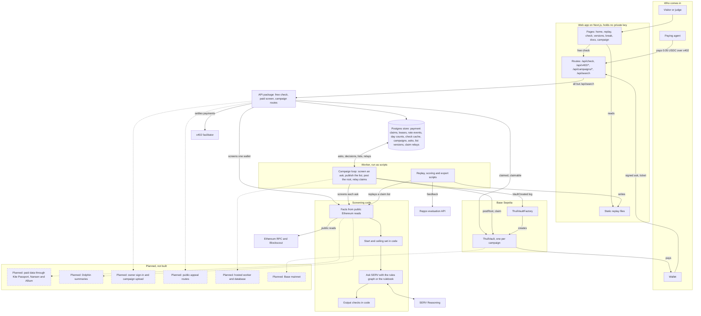
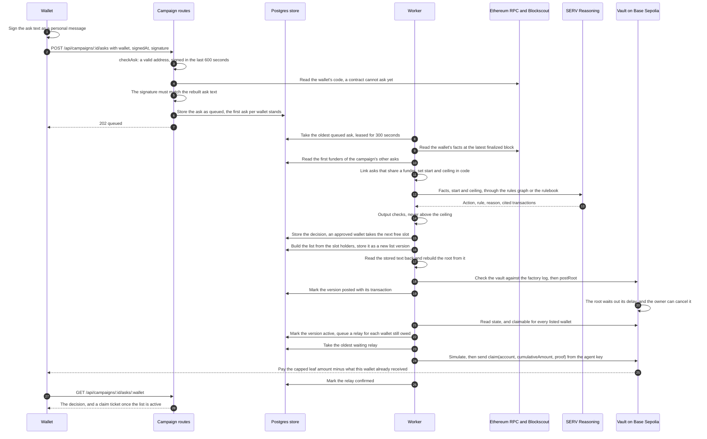
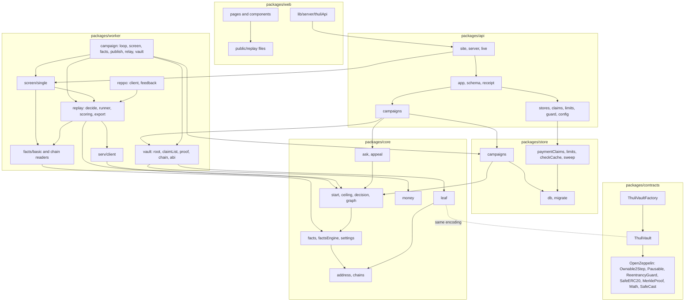

Each diagram below was drawn from the code. Solid lines are built. Dashed lines, and anything labelled planned, are not built yet.

## System overview

Who comes in, what the web app, the API, the worker and the vault each do, and the outside services they call. Every dashed line leads into the planned box, and nothing in that box is built yet.

The free check and the paid route run the same screening inside the request. The paid route is described in [Check a wallet and the paid API](/docs/paid-api).

## One wallet through an open campaign

A wallet signs an ask. The worker screens it, gives an approved wallet a slot, and posts the list's root to the campaign's vault. Once the vault's delay is over, the worker submits each claim, so the wallet is paid without paying gas. Every step here is in the code today.

Whoever submits a claim, the vault pays only the wallet named in the list. More on who can do what in [The reward vault](/docs/vault).

## How the code is split

The packages and their main modules. An arrow points from a module to one it imports, and only the main imports are drawn. The one dashed line is not an import: core's leaf and the vault hash a claim the same way, so a list built in TypeScript proves on chain.

