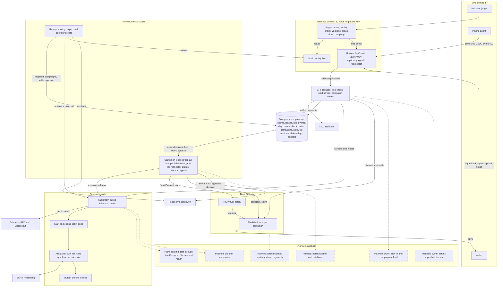
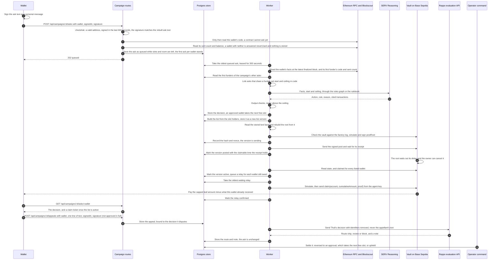
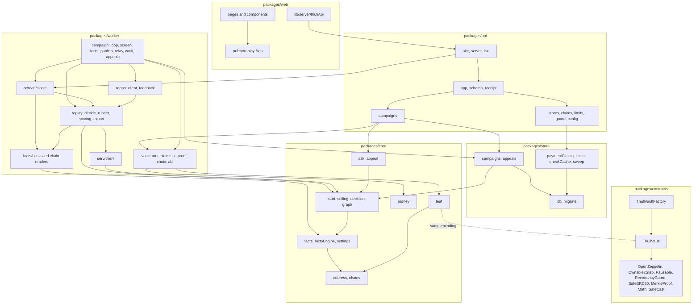

Each diagram below was drawn from the code. Solid lines are built. Dashed lines, and anything labelled planned, are not built yet.

## System overview

Who comes in, what the web app, the API, the worker and the vault each do, and the outside services they call. Every dashed line leads into the planned box, and nothing in that box is built yet.

The free check and the paid route run the same screening inside the request. A paid request answers within 240 seconds, and a paid result is stored so the same payment header fetches it again. The paid route is described in [Check a wallet and the paid API](/docs/paid-api). The vault factory is also deployed on Base mainnet, and its runtime code is identical to the Base Sepolia factory. Its source is verified on Basescan, and on 12 November 2026 it made one proof vault that paid 1 real USDC to a listed wallet and returned the rest to its owner (see [Contracts and addresses](/docs/contracts)). The public campaign and every other address stay on Base Sepolia with test money.

## One wallet through an open campaign

A wallet signs an ask. A wallet that has never been used on Ethereum or on Base is turned away at the door and nothing is stored. The worker screens the rest on the chain where the wallet was active first, gives an approved wallet a slot, and posts the list's root to the campaign's vault, recording the signed post before it sends it. Once the vault's delay is over, the worker submits each claim, so the wallet is paid without paying gas. A wallet that was not approved in full can appeal in one signed line. The worker sends Thuli's decision, with anything that identifies the wallet taken out and never the wallet's own words, to the outside check. The check is advice, and an operator's command makes the owner's call. Every step here is in the code today.

Whoever submits a claim, the vault pays only the wallet named in the list. More on who can do what in [The reward vault](/docs/vault).

## How the code is split

The packages and their main modules. An arrow points from a module to one it imports, and only the main imports are drawn. The one dashed line is not an import: core's leaf and the vault hash a claim the same way, so a list built in TypeScript proves on chain.

