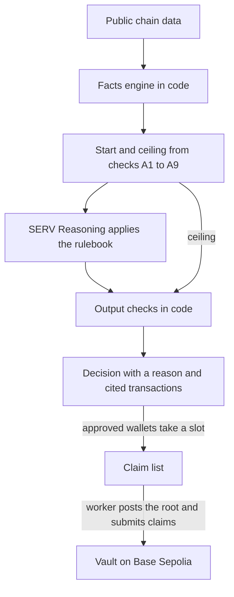

Thuli turns a wallet into a decision in four steps. Code measures and sets every limit. A model, SERV Reasoning by OpenServ, writes the reason. Code then checks the model's answer before it is used.

Every arrow runs today for a campaign on Base Sepolia, from one script on one machine. The free check, the paid check and the replay stop at the decision.

## Step 1. Code reads the chain and works out facts

Thuli reads public Ethereum data for each wallet at a fixed point in time: the block before the first claim in the replay, the latest finalized block in a single-wallet check. Plain code, with no model, works out these facts:

- Age in days and the number of transactions the wallet has sent. Zero-value and failed transfers never count, because anyone can send them.
- Account type: a personal wallet or a contract.
- The first funder: who sent the wallet its first real money, traced back through single-use wallets that only forward money, at most 6 of them. If money is still being passed on at the sixth, that is doubt, not an answer.
- Linked groups: claim wallets joined by the same funder, or by sweeping their funds into the same collector address.
- Shared deposit addresses: an address that a few claim wallets all swept into.
- Funding bursts: 20 or more wallets first funded straight from one exchange on one day in near-equal amounts.
- Whether the claim was paid to a different address, once a claim exists.

An exchange or a contract never links wallets on its own, because they fund many unrelated users. The facts hold only numbers, true or false values, fixed words, addresses and transaction hashes. There is no field for text a stranger wrote on chain, such as a token name, so that text never reaches the model. Limits: only each wallet's first 100 transfers are read, and only native ETH funding is traced, not tokens.

## Step 2. Code sets a start and a ceiling

Nine fixed checks, A1 to A9, run in order and the first match wins. That match is the start: full, partial, hold or exclude. The ceiling is the most generous outcome the code allows, worked out from the same facts. An unreadable fact gives a ceiling of hold. A new, quiet or burst-funded wallet gives partial. Both are set before the model runs. The checks are in [The rulebook](/docs/rulebook).

## Step 3. SERV Reasoning applies the written rulebook

The model reads the facts and the written rulebook and returns an outcome, a reason of at most 280 characters, and the transactions it cites. It is told the start is usually the answer. It can lower a wallet to a hold, with rule B1. In one narrow case it can raise a held wallet, with rule B2, when the shared links look like ordinary infrastructure. It can never go above the ceiling. The reason on each wallet comes from this model, but the code owns every limit: the ceiling, the output checks and the vault's per-wallet cap.

## Step 4. Code checks the answer like untrusted input

A model can err or be steered by text it was shown, so its answer is checked as if a stranger wrote it:

- It must parse as the fixed shape, with one of the four actions.
- The share must match the action: full is 10,000 basis points, partial is the project's setting (5,000 by default), the others 0.
- The reason must be plain text of at most 280 characters, with no links, markup or hidden characters.
- Every cited transaction must be one Thuli itself fetched for that wallet. A made-up or shortened hash in the reason fails too.
- The rule must fit the start, and an exclude needs the self-linked group evidence of rule A3.
- The final outcome is the less generous of the model's answer and the ceiling.

Doubt means hold. A failed check becomes a hold on rule A1 with the cause in plain words. The replay asks a refused answer once more first.

## Payout: the vault and the delay

Wallets with a full or partial decision go onto a claim list, a full wallet at the campaign's reward and a partial wallet at its share rounded down. Held and excluded wallets get nothing. The list becomes one short fingerprint, a Merkle root, on the project's own vault, and Thuli's key can post that fingerprint and nothing else. Every new fingerprint waits out a delay the project sets, from 1 hour to 30 days, so the project can cancel it before it pays. An approved wallet then claims with a proof and is paid to the address on the list. See [The vault](/docs/vault).

A script, the campaign worker, does this today for a campaign. It builds the list from the approved wallets that hold a slot, posts the root, and once the delay is over submits each wallet's claim so the wallet pays no gas. Anyone may submit a claim, and the money still goes only to the address on the list. The first approved wallets take the campaign's slots. Once the slots are gone, the campaign takes no new ask, and an ask that was already waiting is still decided but is not listed. The worker runs with `npm run worker` on one machine, on Base Sepolia with test USDC, and nothing hosts it yet. Its limits are on [Limits and non-goals](/docs/limits).
